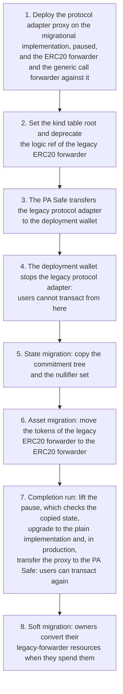

# Galileo Upgrade — Overview

This document gives an overview of the Galileo upgrade: the move of the Anoma Galileo protocol on each chain from its legacy contracts, which are immutable, to contracts that their owners can upgrade. It lists what changes, keeps the three kinds of migration apart, gives the order of the move, and names the documents that specify each part. The domain vocabulary is in [`CONTEXT.md`](../CONTEXT.md).

## 1. What changes

| Part | Legacy | After the Galileo upgrade |
| --- | --- | --- |
| Protocol adapter | One immutable contract per chain. Its owner can stop it, and nothing lifts the stop. | A UUPS proxy that its owner can upgrade, pause and unpause. It stores a kind table root and has two logic ref denylists. |
| State of the protocol adapter | The commitment tree and the nullifier set of the legacy protocol adapter | The same state, copied once into the protocol adapter by the migrational implementation |
| ERC20 forwarder | One immutable contract per chain, which accepts calls only from the legacy protocol adapter | A UUPS proxy at a new address, so its resources have a new label |
| Tokens of the ERC20 forwarder | In the legacy ERC20 forwarder | Moved once to the ERC20 forwarder by `LegacyERC20ForwarderMigration` |
| Generic call forwarder | Immutable | Immutable, deployed again against the protocol adapter. Its resources are ephemeral, so nothing of it migrates. |
| ERC20 transfer circuit | Logic ref `bc1232…`, which the kind tables list as version 1.0.0 | Logic ref `51c2403f…`, version 2.0.0-rc.1. The emergency-migrating circuit, logic ref `47ab0d90…`, is a draft. |
| Resource machine | arm-risc0 1: the kind point of a resource is its kind | arm-risc0 2: the compliance circuit takes the kind point from the kind table |
| Kind tables | None | One kind table per chain and environment, built in [anoma/risc0-kind-tables](https://github.com/anoma/risc0-kind-tables). The protocol adapter stores its root. |

## 2. Three kinds of migration

Three different processes are called migration, and they move different things.

| Process | What moves | Who acts | How often | Specified in |
| --- | --- | --- | --- | --- |
| **State migration** and **asset migration** | The commitment tree and the nullifier set of the legacy protocol adapter are copied into the protocol adapter. The tokens of the legacy ERC20 forwarder move to the ERC20 forwarder. | The deployment wallet and the two Safes | Once per chain that ran a legacy protocol adapter | [`01-state-migration.md`](./01-state-migration.md), and the ERC20 forwarder's [`01-asset-migration.md`](https://github.com/anoma/anomapay-erc20-forwarder/blob/next/docs/01-asset-migration.md) |
| **Soft migration** | Resource owners convert their resources of a deprecated logic ref into resources of the active logic ref. | Each resource owner | After each circuit release, and once for the legacy-forwarder resources of a migrated chain | [`03-resource-kind-migration.md`](./03-resource-kind-migration.md#4-soft-migration) |
| **Hard migration** | Resource owners create resources of the active logic ref from a proof that they hold unspent resources of a denied logic ref. | Each resource owner | After a flaw in a circuit | [`03-resource-kind-migration.md`](./03-resource-kind-migration.md#5-hard-migration), and the ERC20 forwarder's [`03-hard-migration.md`](https://github.com/anoma/anomapay-erc20-forwarder/blob/next/docs/03-hard-migration.md) |

The state migration and the asset migration change no resource. A resource that the legacy protocol adapter created stays the same resource, of the same kind, in the copied commitment tree. Only a soft or a hard migration replaces a resource with a resource of another kind, and the owner of the resource authorizes it.

## 3. The order of the move

On each chain that ran a legacy protocol adapter, the Galileo upgrade runs in this order. [`01-state-migration.md`](./01-state-migration.md#5-steps) gives each step with its signer, and [`01-state-migration.md`](./01-state-migration.md#6-why-this-order) gives the reasons for the order.

The protocol adapter stays paused from step 1 to step 7, so no legacy-forwarder resource can unwrap before its tokens have moved. In production, every chain whose legacy protocol adapter holds user funds moves in one maintenance window. A chain without a legacy protocol adapter starts on the plain implementation. It sets its kind table root and skips the other steps.

After the Galileo upgrade, each change of the protocol adapter or the ERC20 forwarder is an upgrade of its proxy.

## 4. Documents

| Repository | Document | Specifies |
| --- | --- | --- |
| [anoma/pa-evm](https://github.com/anoma/pa-evm) | [`01-state-migration.md`](./01-state-migration.md) | The state migration with `MigrationalProtocolAdapter`, the order of the move, and how anoma-envio indexes both protocol adapters of a chain |
| | [`02-upgrades.md`](./02-upgrades.md) | The upgrades of the protocol adapter in staging and production, the owner actions, and the forced upgrades |
| | [`03-resource-kind-migration.md`](./03-resource-kind-migration.md) | The soft migration and the hard migration, and the controls of the protocol adapter for them |
| [anoma/anomapay-erc20-forwarder](https://github.com/anoma/anomapay-erc20-forwarder) | [`01-asset-migration.md`](https://github.com/anoma/anomapay-erc20-forwarder/blob/next/docs/01-asset-migration.md) | The asset migration with `LegacyERC20ForwarderMigration` |
| | [`02-upgrades.md`](https://github.com/anoma/anomapay-erc20-forwarder/blob/next/docs/02-upgrades.md) | The upgrades of the ERC20 forwarder in staging and production, and the forced upgrades |
| | [`03-hard-migration.md`](https://github.com/anoma/anomapay-erc20-forwarder/blob/next/docs/03-hard-migration.md) | The hard migration of ERC20 resources with `EmergencyMigratingERC20Forwarder` and the emergency-migrating ERC20 circuit |
| [anoma/risc0-kind-tables](https://github.com/anoma/risc0-kind-tables) | [ADR-0008](https://github.com/anoma/risc0-kind-tables/blob/next/docs/adr/0008-kinds-follow-the-forwarder.md) | The rules that every kind table keeps, and its members under the label of the legacy ERC20 forwarder |

The commands are in the `MIGRATION_CHECKLIST.md` and the `RELEASE_CHECKLIST.md` of each repository.
