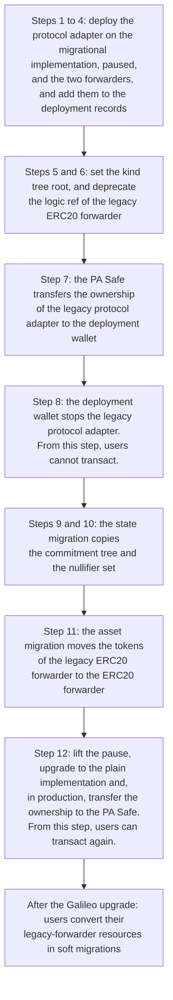

# Galileo Upgrade — Overview

Read this document first. It contains:

- the terms that all documents about the Galileo upgrade use,
- the changes of the Galileo upgrade,
- the three types of migration,
- the order of the Galileo upgrade,
- a list of the documents that specify each part.

Its readers do not need to know the code. Each repository also has a glossary, the file `CONTEXT.md`.

## 1. Purpose

Galileo is the Anoma protocol on EVM chains. Before the Galileo upgrade, the protocol used two immutable contracts on each chain where it ran: the legacy protocol adapter and the legacy ERC20 forwarder. Nobody can change the code of an immutable contract. The Galileo upgrade replaces these contracts with a protocol adapter and an ERC20 forwarder that their owners can upgrade. On a chain with user funds, it also copies the state of the legacy protocol adapter and moves the tokens of the legacy ERC20 forwarder.

A chain gets the Galileo upgrade once. After it, each change of the code of the protocol adapter or of the ERC20 forwarder is an upgrade. In an upgrade, the owner sets a new implementation in the proxy. In these documents, the word upgrade without the word Galileo always means such a change.

## 2. Terms

### The resource machine

- **Anoma resource machine.** The model of the state of the protocol. The state is a set of resources. A transaction consumes resources and creates resources. arm-risc0 is the software of the resource machine. Its circuits use RISC Zero.
- **Resource.** A unit of state, for example an amount of a token that a user owns. Each resource has a **quantity**. The chain does not show the content of a resource. It shows only its commitment and its nullifier.
- **Transaction.** In these documents, a transaction of the resource machine, which the protocol adapter executes. A **chain transaction** is a normal transaction of the EVM chain. A **Safe transaction** is a chain transaction that a Safe executes.
- **Commitment.** A hash of a resource. When a transaction creates a resource, the protocol adapter adds its commitment to the commitment tree.
- **Commitment tree.** A Merkle tree of all commitments. The tree only grows. A **Merkle path** is the list of hashes that connects a commitment to a root of the tree. So a Merkle path proves that a resource exists.
- **Historical root.** A root of the commitment tree that the protocol adapter stores. A transaction proves each resource that it consumes against a historical root.
- **Nullifier.** A value that only the user who owns a resource can calculate. When a transaction consumes a resource, the protocol adapter adds its nullifier to the **nullifier set**. The protocol adapter reverts a transaction with a nullifier that is already in the set. So no second transaction can consume the same resource. A resource whose nullifier is not in the set is **unspent**.
- **Persistent and ephemeral resources.** A persistent resource stays unspent until a later transaction consumes it. An ephemeral resource exists only in one transaction. A transaction can create an ephemeral resource that no transaction consumes, or consume an ephemeral resource that no transaction created. The proof for a consumed ephemeral resource uses the root of the empty tree, which is always a historical root. Wraps, unwraps and the trigger of a hard migration use ephemeral resources.
- **Action.** A part of a transaction. An action consumes resources and creates resources. The **action tree root** is a hash over the nullifiers and the commitments of an action. Users sign this hash.

### Circuits and proofs

- **Circuit.** A program for which a **prover** makes a proof. The proof shows that the program accepted its inputs. It does not show the secret inputs. In these documents, a prover is the software that makes the proofs of a transaction, for example the AnomaPay backend. RISC Zero is the proof system that makes and verifies the proofs.
- **Resource logic.** The circuit that decides when a transaction can create or consume a resource. Its **logic ref** identifies its code. A **version** of a resource logic is one release of its code, with its own logic ref. A **circuit release** publishes a new version.
- **Compliance circuit.** The circuit that checks the rules of the resource machine for each action. For example, it checks that each consumed resource exists in the commitment tree.
- **Aggregation circuit.** The circuit of the aggregation proof. The aggregation proof proves the compliance proofs and the resource logic proofs of a transaction together.
- **Delta proof.** The proof that a transaction consumes and creates the same quantity for each kind point. A transaction with a valid delta proof **balances**.
- **Verifying key.** The value with which a verifier checks the proofs of one circuit.

### Kinds

- **Label ref.** The hash of the data that separates resources with the same resource logic. For an ERC20 resource, the data are the address of a forwarder and the address of a token. So the label ref of an ERC20 resource names one forwarder and one token.
- **Kind.** The hash of the logic ref and the label ref of a resource. The commitment covers both refs, so the kind of a resource never changes.
- **Kind point.** A point on an elliptic curve. The compliance circuit multiplies the kind point of each resource by its quantity, and the delta proof adds the results. Without a kind table entry, the compliance circuit calculates the kind point from the kind. Then two different kinds have different kind points.
- **Kind table.** A list of entries. Each entry gives one kind the kind point of another kind. Two kinds with the same kind point are **fungible**. A transaction can then consume a resource of one kind and create a resource of the other kind. Such a transaction is a **conversion**. The protocol adapter stores the **kind tree root**, the root of a Merkle tree over all entries. The **kind tables repository**, [anoma/risc0-kind-tables](https://github.com/anoma/risc0-kind-tables), makes the kind tables and publishes their roots.

### Contracts and applications

- **Protocol adapter.** The contract that verifies the proofs of a transaction and updates the commitment tree and the nullifier set. The **legacy protocol adapter** is the immutable protocol adapter that a chain used before the Galileo upgrade. Without the word legacy, the term protocol adapter means the new, upgradeable contract.
- **Application.** A set of resource logics and contracts that work together, for example AnomaPay.
- **Forwarder.** A contract of an application that the protocol adapter calls. A resource can contain **forwarder calls**. Its resource logic proof covers them, and the protocol adapter makes each call when it processes the resource.
- **ERC20 forwarder.** The forwarder that holds the ERC20 tokens of AnomaPay. A **wrap** moves an amount of a token into it and creates an **ERC20 resource** with that quantity. An **unwrap** consumes an ERC20 resource and sends the tokens to a receiver. The **ERC20 resource logic** is the resource logic of ERC20 resources. The **legacy ERC20 forwarder** is the immutable ERC20 forwarder that worked with the legacy protocol adapter. Without the word legacy, the term ERC20 forwarder means the new, upgradeable contract.
- **Active version.** The version of the ERC20 resource logic that the ERC20 forwarder accepts. The AnomaPay backend creates resources only of the active version.
- **Legacy-forwarder resource.** An ERC20 resource whose label ref names the legacy ERC20 forwarder. The **legacy-forwarder entries** of a kind table give each kind of these resources the kind point of one kind of the ERC20 forwarder. That kind has the same token, the logic ref of the active version, and the label ref of the ERC20 forwarder.
- **Generic call forwarder.** A forwarder that makes calls to other contracts for a transaction, for example for a token swap. Its resources are ephemeral, so none of them stays in the state.
- **AnomaPay.** The application that lets users wrap, transfer and unwrap ERC20 tokens as private resources. The **AnomaPay backend** is the service that makes and proves the transactions of the AnomaPay app.

### Upgradeable contracts

- **Proxy and implementation.** The protocol adapter and the ERC20 forwarder are ERC-1967 proxies. A proxy keeps its address and its state, and it runs the code of a separate implementation contract. An upgrade sets a new implementation in the proxy. In the UUPS pattern, the upgrade function is in the implementation, and only the owner of the proxy can call it.
- **Plain and migrational implementation.** `ProtocolAdapter` is the plain implementation of the protocol adapter. `MigrationalProtocolAdapter` is a variant of it that can copy the state of a legacy protocol adapter. A protocol adapter uses it only during its state migration.
- **Migrated chain.** A chain whose protocol adapter copied the state of its legacy protocol adapter.
- **CREATE2.** A method that deploys a contract to an address that anyone can calculate before the deployment. The address follows from the deployer, the code and a **salt**: a value that the deployer selects.
- **Revert.** A call reverts when it fails. A call that reverts changes nothing.
- **Deployment record.** The file `crates/bindings/deployments.json` of a repository. It lists the deployed contracts of each environment and the legacy contracts of each chain.
- **Bindings.** The Rust package of a repository. Other repositories use it to call the contracts.

### Accounts and controls

- **The team.** The team of the Anoma Foundation that deploys and operates the contracts.
- **Deployment wallet.** The account `0x61462bE56782568376f9cB069382EFa72764a407`, which has one private key. The team uses it to deploy contracts. It owns the staging contracts.
- **Safe.** A contract account with several owners, the **signers**. A Safe transaction executes only after enough signers confirm it.
- **PA Safe.** The Safe of the protocol adapters (PA), `0xE9082Ac8Aa2Fb27DEfDBAC604921C196b884Da10`. It owns the production protocol adapters. It needs 3 of its 5 signers.
- **FWD Safe.** The Safe of the forwarders (FWD), `0xc703402252Ce1251aa07e0815D50060d27fdd6C4`. It owns the production ERC20 forwarders, and it controls the emergency functions of the legacy ERC20 forwarders. It needs 3 of its 5 signers.
- **Environment.** One of two deployments of the contracts: staging and production. A chain can have both. The team tests changes in staging before it deploys them to production. The deployment wallet owns the staging contracts, and the two Safes own the production contracts.
- **Pause.** The owner of the protocol adapter can pause it. A paused protocol adapter executes no transaction until its owner lifts the pause.
- **Deprecate and deny.** The protocol adapter keeps two **denylists** of logic refs: one for created resources and one for consumed resources. To **deprecate** a logic ref, the owner adds it to the list for created resources. Then no transaction can create resources with that logic ref. To **deny** a logic ref, the owner adds it to both lists. Then no transaction can create or consume resources with that logic ref. No function removes an entry. Only an upgrade of the protocol adapter can remove one.
- **ADR.** An architecture decision record: a short document that states one decision and its reasons.

## 3. Changes

| Part | Before the Galileo upgrade | After the Galileo upgrade |
| --- | --- | --- |
| Protocol adapter | An immutable contract. Its owner can stop it, and nothing lifts the stop. | A proxy that its owner can upgrade and pause. It stores a kind tree root and has two denylists. |
| State of the protocol adapter | The commitment tree and the nullifier set of the legacy protocol adapter | The commitment tree and the nullifier set, copied once. The older roots are not copied. |
| ERC20 forwarder | An immutable contract that accepts calls only from the legacy protocol adapter | A proxy at a new address. So its resources have new label refs. |
| Tokens | In the legacy ERC20 forwarder | In the ERC20 forwarder, after one move |
| Generic call forwarder | Immutable | Immutable, and deployed again for the protocol adapter. Its resources are ephemeral, so nothing of it migrates. |
| ERC20 resource logic | Version 1.0.0 | Version 2.0.0-rc.1. The emergency-migrating circuit is a draft. |
| Resource machine | arm-risc0 1: the compliance circuit always calculates the kind point from the kind. | arm-risc0 2: the compliance circuit reads kind points from the kind table. |
| Kind tables | None | One kind table for each chain and environment |

The logic refs of the ERC20 resource logic are:

| Version | Logic ref | Use |
| --- | --- | --- |
| 1.0.0 | `bc12323668c37c3d381ca798f11116f35fb1639d12239b29da7810df3985e7ad` | The legacy ERC20 forwarders accept it. Each migrated chain deprecates it. |
| 2.0.0-rc.1 | `51c2403f4e1de40c3c3ecef69385f8772ee99b4a610e88f1ad2b1b85b481a7f2` | The active version. The ERC20 forwarders accept it. |
| The emergency-migrating circuit | `47ab0d901b35909c87c6c08463393205ae42f11ca4af3dd48416606bb02fbcc2` | A draft for the hard migration. No environment uses it. |

The other documents use the first eight hexadecimal digits of each logic ref: `bc123236…`, `51c2403f…` and `47ab0d90…`.

## 4. Three types of migration

These documents use the word migration for three types of process. The first type has two parts.

| Type | What moves | Who acts | When | Specified in |
| --- | --- | --- | --- | --- |
| **State migration** and **asset migration** | The protocol adapter copies the commitment tree and the nullifier set of the legacy protocol adapter. The tokens of the legacy ERC20 forwarder move to the ERC20 forwarder. | The team, with the deployment wallet and the two Safes | Once, on each migrated chain | [`01-state-migration.md`](./01-state-migration.md), and the ERC20 forwarder's [`01-asset-migration.md`](https://github.com/anoma/anomapay-erc20-forwarder/blob/next/docs/01-asset-migration.md) |
| **Soft migration** | Users replace their resources of a deprecated version with resources of a new version, with conversions. | Each user | After each circuit release, and once for the legacy-forwarder resources of a migrated chain | [`03-resource-kind-migration.md`](./03-resource-kind-migration.md#4-soft-migration) |
| **Hard migration**, which the code calls emergency migration | Users create resources of a new version from a proof that they own unspent resources of a denied version. | Each user | After a flaw in a resource logic | [`03-resource-kind-migration.md`](./03-resource-kind-migration.md#5-hard-migration), and the ERC20 forwarder's [`03-hard-migration.md`](https://github.com/anoma/anomapay-erc20-forwarder/blob/next/docs/03-hard-migration.md) |

The state migration and the asset migration change no resource. A resource that the legacy protocol adapter created stays the same resource, with the same kind, in the copied commitment tree. Only a soft migration or a hard migration replaces a resource with a resource of another kind. The user who owns the resource signs the replacement. These two types are the resource kind migrations.

## 5. Order of the Galileo upgrade

The Galileo upgrade of a migrated chain has these parts. The numbers are the numbers of the steps in [`01-state-migration.md`](./01-state-migration.md#5-steps), which also gives the signer of each step and the reasons for the order.

In production, the team does steps 8 to 12 on all migrated chains in one planned period without transactions. On a chain without a state migration, the team deploys the protocol adapter on the plain implementation, and the two forwarders. Then it sets the kind tree root. That chain has no other steps.

## 6. Documents

| Repository | Document | Specifies |
| --- | --- | --- |
| [anoma/pa-evm](https://github.com/anoma/pa-evm) | [`01-state-migration.md`](./01-state-migration.md) | The state migration, all steps of the Galileo upgrade of a migrated chain, and how the indexers read the events of both protocol adapters of a chain |
| | [`02-upgrades.md`](./02-upgrades.md) | The upgrades of the protocol adapter in staging and production, the other actions of its owner, and the response to a flaw |
| | [`03-resource-kind-migration.md`](./03-resource-kind-migration.md) | The soft migration and the hard migration, and how the protocol adapter supports them |
| [anoma/anomapay-erc20-forwarder](https://github.com/anoma/anomapay-erc20-forwarder) | [`01-asset-migration.md`](https://github.com/anoma/anomapay-erc20-forwarder/blob/next/docs/01-asset-migration.md) | The asset migration |
| | [`02-upgrades.md`](https://github.com/anoma/anomapay-erc20-forwarder/blob/next/docs/02-upgrades.md) | The upgrades of the ERC20 forwarder, and the response to a flaw |
| | [`03-hard-migration.md`](https://github.com/anoma/anomapay-erc20-forwarder/blob/next/docs/03-hard-migration.md) | The hard migration of ERC20 resources |
| [anoma/risc0-kind-tables](https://github.com/anoma/risc0-kind-tables) | [ADR-0008](https://github.com/anoma/risc0-kind-tables/blob/next/docs/adr/0008-kinds-follow-the-forwarder.md) | The rules for the kind tables, and the legacy-forwarder entries |

The commands are in the files `MIGRATION_CHECKLIST.md` and `RELEASE_CHECKLIST.md` of each repository.
