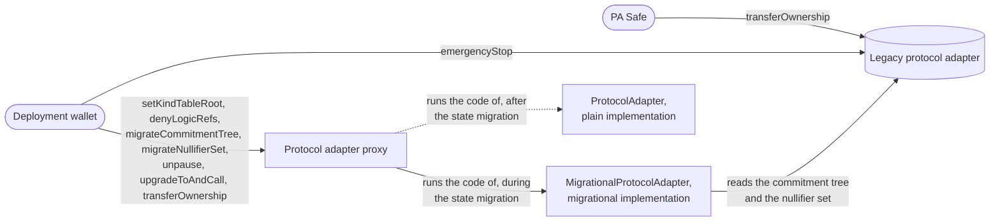
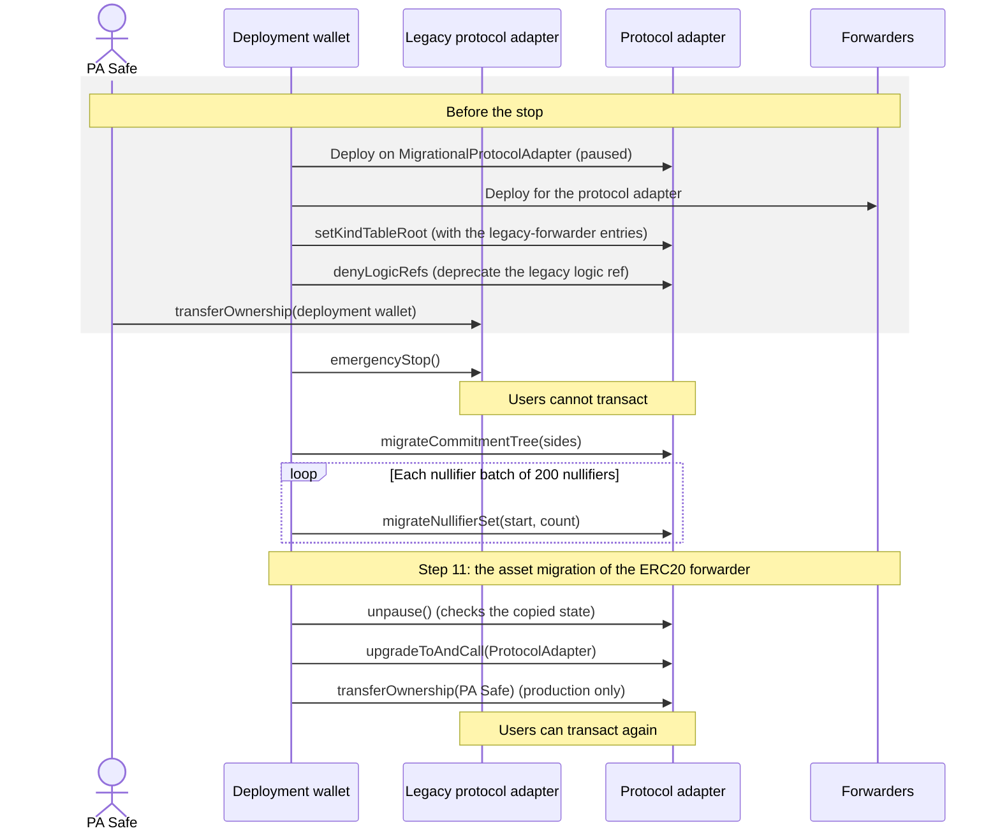
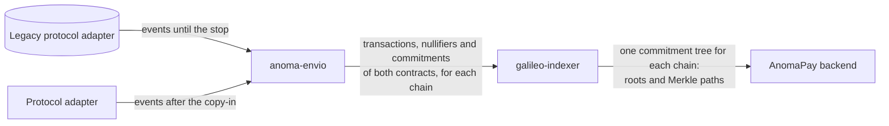

# State Migration — Specification & Architecture

This document specifies the state migration: the one-time copy of the state of a legacy protocol adapter into the protocol adapter. It also gives all steps of the Galileo upgrade of a migrated chain, and the reasons for their order. Its last part explains how the indexers read the events of both contracts. The [overview](./00-galileo-upgrade.md) explains the terms. [`MIGRATION_CHECKLIST.md`](../MIGRATION_CHECKLIST.md) has the commands.

## 1. Purpose

The legacy protocol adapter of a chain contains the commitment tree and the nullifier set of that chain. Without the commitment tree, no user can prove that their resources exist. Without the nullifier set, the protocol adapter cannot reject a second consumption of a resource. The legacy protocol adapter is immutable, so no upgrade can change it. So the protocol adapter copies the commitment tree and the nullifier set from the legacy protocol adapter.

The state migration happens once on each migrated chain. Nothing lifts the stop of the legacy protocol adapter, so the chain cannot use it again. After the state migration, each change of the code of the protocol adapter is an upgrade, as [`02-upgrades.md`](./02-upgrades.md) specifies. A chain without a legacy protocol adapter, or with an empty legacy commitment tree, starts on the plain implementation and has no state migration.

## 2. Three types of migration

The Galileo upgrade has three types of migration. The [overview](./00-galileo-upgrade.md#4-three-types-of-migration) compares them. This document covers the state migration.

## 3. Contracts and owners

- **Legacy protocol adapter.** It has no kind table and no denylists. Its owner can call only `emergencyStop` and the functions that transfer the ownership. No function lifts the stop.
- **Migrational implementation.** `MigrationalProtocolAdapter`. Section [4](#4-the-migrational-implementation) specifies it.
- **Plain implementation.** `ProtocolAdapter`. [`02-upgrades.md`](./02-upgrades.md#1-contracts-and-owners) specifies it.

| Contract | Before the state migration | During the state migration | After the state migration |
| --- | --- | --- | --- |
| Legacy protocol adapter | The PA Safe owns it. | The deployment wallet owns it from step 7. The deployment wallet stops it in step 8. | It stays stopped. |
| Protocol adapter | — | The deployment wallet owns it in both environments, because it sends the calls of steps 10 and 12. | The deployment wallet owns it in staging. The PA Safe owns it in production. |

## 4. The migrational implementation

`MigrationalProtocolAdapter` is a `ProtocolAdapter` with three changes:

- `initialize` pauses the protocol adapter. So the protocol adapter executes no transaction before the copy ends.
- Two functions copy the state. These documents call them the **copy-in**. Only the owner can call them, and only while the protocol adapter is paused and the legacy protocol adapter is stopped. So the state that they read does not change.
- `unpause` lifts the pause only after a complete copy.

**`migrateCommitmentTree(sides)`** writes the commitment tree in one call. It works only on an empty tree. The caller supplies the sides: the hashes that the legacy protocol adapter stores for the left part of each level of its tree. The legacy protocol adapter has no function that returns the sides, so the script reads them from its storage. The function reads the number of commitments and the latest root from the legacy protocol adapter. It takes the depth of the tree from the number of sides, and it calculates the roots of the empty subtrees. Then it calculates the root of the result. If this root is not the latest root of the legacy protocol adapter, the function reverts. So the function cannot write wrong sides. The function also reverts if the legacy commitment tree is empty.

**`migrateNullifierSet(start, count)`** copies `count` nullifiers. The legacy protocol adapter returns each nullifier by its index, in the order in which it added them. The function copies the nullifiers from the index `start`, and it reads each one from the legacy protocol adapter. It reverts in two cases:

- `start` is not zero, and the nullifier set does not contain the nullifier at the index `start − 1`. So a nullifier batch cannot skip nullifiers.
- The nullifier set already contains a nullifier of the batch. So a nullifier batch cannot copy a nullifier twice.

**`unpause`** checks four conditions:

1. The protocol adapter has the same number of commitments as the legacy protocol adapter.
2. It has the same latest root.
3. The root of the empty tree and that latest root are historical roots.
4. If the legacy protocol adapter has nullifiers, the nullifier set contains its last nullifier. The nullifier batches copy the nullifiers in their order, so the last nullifier shows that the copy-in copied all of them.

If a condition is false, the protocol adapter stays paused. So it cannot execute transactions with only part of the state.

**The upgrade to the plain implementation** removes the copy-in. No other step removes it, so each state migration must end with this upgrade. The migrational implementation emits `MigrationFinalized` when it authorizes the upgrade. It has no storage of its own. So after the upgrade, no storage of the migrational implementation remains.

**Historical roots.** The legacy protocol adapter keeps all roots that it ever stored. The protocol adapter keeps only two of them:

- the root of the empty tree, for the ephemeral resources that a transaction consumes,
- the latest root of the legacy protocol adapter.

A prover with a Merkle path for an older root must calculate a new Merkle path for the latest root.

## 5. Steps

The Galileo upgrade of a migrated chain has these steps. Steps 10 and 12 are the state migration. Step 11 is the asset migration. The commands are in the file `justfile` of the repository, and `MIGRATION_CHECKLIST.md` lists them.

| # | Step | Signer |
| --- | --- | --- |
| 1 | Deploy the plain implementation, and publish its source code on sourcify and Etherscan. The scripts of steps 10 and 12 refuse to start without this implementation. | Deployment wallet |
| 2 | Deploy the protocol adapter on the migrational implementation. The environment variable `IS_MIGRATIONAL=true` selects this implementation. The protocol adapter starts paused. | Deployment wallet |
| 3 | Add the protocol adapter to the deployment record, and publish a new version of the bindings. The scripts and the kind tables repository read its address from the deployment record. | — |
| 4 | Deploy the ERC20 forwarder and the generic call forwarder for the protocol adapter, and add them to the deployment records of their repositories. The deployment record of the ERC20 forwarder also lists the legacy ERC20 forwarder of the chain. | Deployment wallet |
| 5 | Set the kind table root. The kind table contains the legacy-forwarder entries. | Deployment wallet |
| 6 | Deprecate the logic ref of the legacy ERC20 forwarder with `denyLogicRefs([(logicRef, false)])`. The value `false` selects the list for created resources. | Deployment wallet |
| 7 | Transfer the ownership of the legacy protocol adapter to the deployment wallet. The legacy protocol adapter continues to execute transactions. So this step can occur days before step 8. | PA Safe |
| 8 | Stop the legacy protocol adapter with `emergencyStop()`. From this step, users cannot transact. | Deployment wallet |
| 9 | Read the latest root, the number of commitments and the number of nullifiers of the stopped legacy protocol adapter. The team uses them to plan step 10 and to check the result. | — |
| 10 | The migration run: a script run that calls the copy-in. The protocol adapter stays paused. | Deployment wallet |
| 11 | The asset migration: move the tokens of the legacy ERC20 forwarder to the ERC20 forwarder. | Deployment wallet and FWD Safe |
| 12 | The completion run: a script run that lifts the pause, upgrades to the plain implementation and, in production, transfers the ownership to the PA Safe. From this step, users can transact again. | Deployment wallet |
| 13 | Compare the protocol adapter with the stopped legacy protocol adapter (`contracts-check-migration`). | — |

The ERC20 forwarder's [`01-asset-migration.md`](https://github.com/anoma/anomapay-erc20-forwarder/blob/next/docs/01-asset-migration.md) specifies step 11.

## 6. Reasons for the order

- **Steps 5 and 6 occur before the stop.** A paused protocol adapter accepts both calls. So these steps do not make the time without transactions longer.
- **The protocol adapter stays paused until the tokens move.** The ERC20 forwarder's [`01-asset-migration.md`](https://github.com/anoma/anomapay-erc20-forwarder/blob/next/docs/01-asset-migration.md#9-reason-for-the-order) gives the reason.
- **Step 6 occurs before the completion run lifts the pause.** [`03-resource-kind-migration.md`](./03-resource-kind-migration.md#case-2-the-legacy-erc20-forwarder) gives the reason.
- **The deployment wallet stops the legacy protocol adapter, not the PA Safe.** So no Safe transaction is necessary between the stop and the migration run. The ownership lets the deployment wallet do only one important action: the stop.
- **Step 9 occurs after the stop.** Before the stop, the legacy protocol adapter can still execute transactions and change the values.
- **The completion run lifts the pause before it upgrades.** Only the `unpause` of the migrational implementation checks the copied state. The `unpause` of the plain implementation checks nothing.

## 7. Staging and production

| | Staging | Production |
| --- | --- | --- |
| Owner of the protocol adapter during the state migration | The deployment wallet | The deployment wallet |
| Owner after the completion run | The deployment wallet | The PA Safe. The completion run transfers the ownership in its last call. |
| Promotion gate during the state migration | It accepts a protocol adapter on the migrational implementation that the source code predicts. | The same. It also fails for the chain until the completion run transfers the ownership to the PA Safe. |
| Chains | Sepolia. The team tested all steps on it. | All migrated chains, in one planned period without transactions |

[`02-upgrades.md`](./02-upgrades.md#2-environments-and-promotion) explains the promotion gate. A promotion can occur while a chain is in its state migration, for example for a change on the other chains.

The tokens of a legacy ERC20 forwarder can move to the ERC20 forwarder of only one environment ([`01-asset-migration.md`](https://github.com/anoma/anomapay-erc20-forwarder/blob/next/docs/01-asset-migration.md#10-staging-and-production)).

A chain can also start an environment without a state migration, while its legacy protocol adapter continues to work. The staging deployment on Base Sepolia does this. Its protocol adapter starts on the plain implementation with an empty tree. The legacy-forwarder resources of that chain stay in the legacy commitment tree, and users use them through the legacy protocol adapter.

## 8. Duration

Users cannot transact from the stop of the legacy protocol adapter (step 8) until the completion run lifts the pause (step 12). The team does steps 1 to 7 before the stop. Steps 9 to 12 must occur after the stop. Three of them take the most time:

- The migration run sends one chain transaction for the commitment tree, and one for each nullifier batch of `NULLIFIERS_PER_BATCH` (200) nullifiers. For example, the stopped legacy protocol adapter on Sepolia contains 4,239 nullifiers, so its migration run sends 23 chain transactions.
- The asset migration needs a Safe transaction: 3 of the 5 FWD Safe signers confirm the emergency caller.
- The completion run sends one chain transaction to lift the pause, one to upgrade and, in production, one to transfer the ownership.

The scripts use the Foundry option `--slow`: they send a chain transaction only after the chain includes the previous one. So a revert ends the run. A script skips each call whose result is already on the chain. So after a failure, the team runs the script again, and it continues where it ended.

## 9. Events and the indexer

anoma-envio is an indexer: it stores the events of the protocol adapters in a database. The galileo-indexer reads these events, builds the commitment tree of each chain, and gives Merkle paths to the AnomaPay backend.

On a migrated chain, the events of one commitment tree come from two contracts. The legacy protocol adapter emitted the events of the commitments until its stop. The protocol adapter emits the events of the commitments after the copy-in. The copy-in emits no event for each copied commitment or nullifier. It emits only these events:

- `CommitmentTreeRootAdded` with the latest root of the legacy protocol adapter, and `CommitmentTreeMigrated(root, leafCount)`, from `migrateCommitmentTree`,
- `NullifierBatchMigrated(start, count)`, from each nullifier batch.

So an indexer that reads only the protocol adapter does not find the resources that the legacy protocol adapter created. For this reason, [anoma-envio](https://github.com/anoma/anoma-envio) indexes both contracts of a migrated chain. Its branch `pa-v2` contains the version for the Galileo upgrade:

- **Two contract names.** Its configuration calls the legacy protocol adapter `ProtocolAdapterV1` and the protocol adapter `ProtocolAdapterV2`. Nine events have the same signature in both contracts. For each of them, one handler, the code that processes an event, processes the events of both contracts. The events `ActionExecuted` and `TransactionExecuted` are different in the two contracts, so each contract has its own handlers for them. The `ActionExecuted` event of the legacy protocol adapter contains only the action tree root and the number of nullifiers and commitments. So its handler reads the nullifiers and the commitments from the calldata of the chain transaction.
- **Contracts for each chain.** On a migrated chain, the configuration lists the legacy protocol adapter from its deployment block. It lists the protocol adapter from its own deployment block. On a chain without a state migration, the configuration lists only the protocol adapter, because the legacy protocol adapter there has a different commitment tree. A comment in the configuration states this rule. No check enforces it.
- **One set of tables.** The rows of both contracts go into the same tables. Each row identifier starts with the chain ID. The identifier of a nullifier or a commitment also contains the address of the contract that emitted it.
- **No events of the copy-in.** anoma-envio does not index `CommitmentTreeMigrated`, `NullifierBatchMigrated` or `MigrationFinalized`. The copied commitments and nullifiers are in the database as the rows of the legacy protocol adapter.

The galileo-indexer builds one commitment tree for each chain from the rows of both contracts. It orders the transactions of a chain by block number and log index. In a transaction, it orders the commitments by action and by their position in the action. This order gives the commitment tree of the protocol adapter, for three reasons:

- The database contains every commitment of the legacy protocol adapter, because anoma-envio reads the legacy protocol adapter from its deployment block.
- `migrateCommitmentTree` continues the tree after the last commitment of the legacy protocol adapter.
- The copy-in occurs only after the stop, and the completion run lifts the pause only after the copy-in. So no transaction of the legacy protocol adapter follows a transaction of the protocol adapter.

The protocol adapter does not reject a commitment that the tree already contains. So each commitment in an event is one leaf of the tree, also when the same commitment occurs a second time. An indexer that keeps only one row for a repeated commitment builds a different tree from the second leaf to the end.

The protocol adapter emits two `CommitmentTreeRootAdded` events before its first transaction. The first contains the root of the empty tree, from `initialize`. The second contains the latest root of the legacy protocol adapter, from `migrateCommitmentTree`. The database also contains the older roots of the legacy protocol adapter, which the protocol adapter does not accept (see [Historical roots](#4-the-migrational-implementation)).

## 10. Trust assumptions

- **The team keeps the order of the steps.** `unpause` checks the copied state, but it does not check the asset migration. Only the order of the steps keeps the pause until the tokens move. If the team lifts the pause too early, legacy-forwarder resources can unwrap tokens that other resources represent.
- **The deployment wallet alone owns each legacy protocol adapter from step 7.** So the deployment wallet can stop the legacy protocol adapter at any time. The ownership transfer completes in one step, so a transfer to a wrong address makes the stop impossible. For this reason, the script `ProposeLegacyProtocolAdapterOwnershipTransfer` reads the address from the file `Parameters.sol`, and never from an argument.
- **The deployment wallet alone owns a production protocol adapter until the completion run.** Until then, it alone can upgrade the protocol adapter. The completion run transfers the ownership to the PA Safe in its last call.
- **A protocol adapter with an incomplete copy stays paused.** `unpause` refuses an incomplete copy. The protocol adapter already uses its CREATE2 address, so no new deployment can replace it at that address. So the team runs the scripts again until they complete.

## 11. Parameters

| Name | Value | Use |
| --- | --- | --- |
| `IS_MIGRATIONAL` | `true` | An environment variable of the deploy script. It deploys a protocol adapter on the migrational implementation. |
| `Parameters.IMPLEMENTATION_SALT` | `"ProtocolAdapterImpl"` | CREATE2 salt of the migrational and the plain implementation |
| `NULLIFIERS_PER_BATCH` | `200` | Number of nullifiers in each chain transaction of the migration run |

The [overview](./00-galileo-upgrade.md#accounts-and-controls) gives the addresses of the deployment wallet and the Safes. The deployment record, [`crates/bindings/deployments.json`](../crates/bindings/deployments.json), lists the legacy protocol adapter of each chain under `legacy`.
