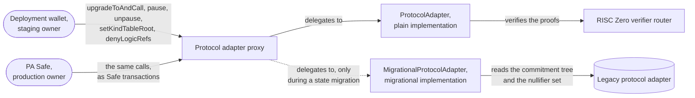
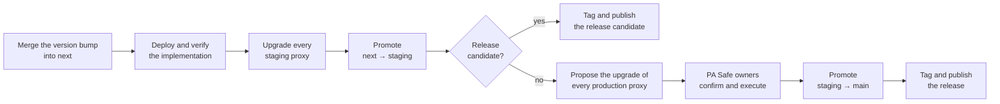
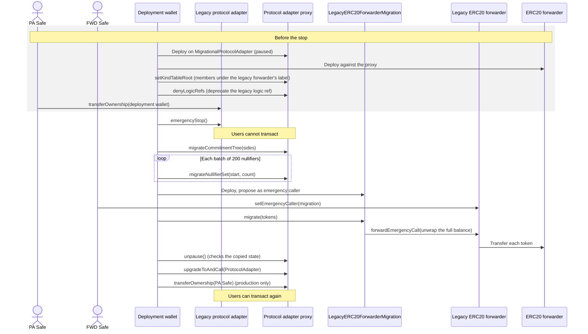
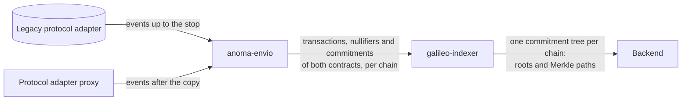

# Upgrades and State Migration — Specification & Architecture

This document specifies how the protocol adapter changes after its first deployment, in the staging and the production environment, and how a chain moves the state of its legacy protocol adapter into the protocol adapter. It also states how anoma-envio indexes the events of both contracts on one chain. The domain vocabulary is in [`CONTEXT.md`](../CONTEXT.md). The commands are in [`RELEASE_CHECKLIST.md`](../RELEASE_CHECKLIST.md) and [`MIGRATION_CHECKLIST.md`](../MIGRATION_CHECKLIST.md); this document gives the order of the steps and the reasons for it. How resource owners move their resources from one kind to another is in [`02-resource-kind-migration.md`](./02-resource-kind-migration.md).

## 1. Three kinds of migration

Three different processes are called migration, and they move different things. This document covers the state migration. The documents in the last column cover the rest.

| Process | What moves | Who acts | How often | Specified in |
| --- | --- | --- | --- | --- |
| **State migration** and **asset migration** | The commitment tree and the nullifier set of the legacy protocol adapter are copied into the protocol adapter. The tokens of the legacy ERC20 forwarder move to the ERC20 forwarder. | The deployment wallet and the two Safes | Once per chain that ran a legacy protocol adapter | Section [State migration](#6-state-migration), and the ERC20 forwarder's [`01-upgrades-and-asset-migration.md`](https://github.com/anoma/anomapay-erc20-forwarder/blob/next/docs/01-upgrades-and-asset-migration.md) |
| **Soft migration** | Resource owners convert their resources of a deprecated logic ref into resources of the active logic ref. | Each resource owner | After each circuit release, and once for the legacy-forwarder resources of a migrated chain | [`02-resource-kind-migration.md`](./02-resource-kind-migration.md#4-soft-migration) |
| **Hard migration** | Resource owners create resources of the active logic ref from a proof that they hold unspent resources of a denied logic ref. | Each resource owner | After a flaw in a circuit | [`02-resource-kind-migration.md`](./02-resource-kind-migration.md#5-hard-migration) |

The state migration and the asset migration change no resource. A resource that the legacy protocol adapter created stays the same resource, of the same kind, in the copied commitment tree. Only a soft or a hard migration replaces a resource with a resource of another kind, and the owner of the resource authorizes it.

## 2. Contracts and owners

- **Protocol adapter.** An ERC-1967 proxy that delegates every call to its implementation. It upgrades with UUPS: the implementation authorizes the upgrade, and only the owner can do it. The proxy keeps its address, its commitment tree, its nullifier set, its kind table root and its denylists across upgrades. Its address comes from CREATE2 and commits to the salt of its environment, to the implementation that it starts on and to its first owner.
- **Plain implementation.** `ProtocolAdapter`, the implementation that every chain ends on. Its bytecode fixes `VERSION`, the RISC Zero verifier router and selector, and the verifying keys of the compliance and aggregation circuits (`VerifyingKeys`). So a change to any of them is an upgrade. Both environments deploy it with one CREATE2 salt, so each version has one address per chain, which both environments share.
- **Migrational implementation.** `MigrationalProtocolAdapter`, a protocol adapter that starts paused and copies the state of the legacy protocol adapter in. Section [State migration](#6-state-migration) specifies it.
- **Legacy protocol adapter.** The immutable protocol adapter that a chain ran before. It has no kind table and no denylists. Its owner can only call `emergencyStop` and the `Ownable` functions, and no function lifts the stop.

The owner of the proxy can upgrade it (`upgradeToAndCall`), pause it and lift the pause (`pause`, `unpause`), set the kind table root (`setKindTableRoot`), add logic refs to the denylists (`denyLogicRefs`), and transfer ownership.

| Environment | Owner | How the owner acts | Branch |
| --- | --- | --- | --- |
| Staging | the deployment wallet `0x61462bE56782568376f9cB069382EFa72764a407` | sends each transaction directly | `staging` |
| Production | the PA Safe `0xE9082Ac8Aa2Fb27DEfDBAC604921C196b884Da10`, a Safe multisig that needs 3 of its 5 owners to confirm a transaction | a script proposes the transaction, and the Safe owners confirm and execute it in the Safe app | `main` |

## 3. Environments and promotion

Changes go in one direction: `next` → `staging` → `main` ([ADR-0003](./adr/0003-deployments-are-promoted-from-next-through-staging-to-main.md)). `next` collects the feature branches and makes no statement about deployments. A pull request into `staging` passes only if every staging proxy runs the implementation that the source predicts for its chain. A pull request into `main` passes only if every production proxy runs it, its version has no prerelease suffix, and a Safe owns the proxy. So a deployment follows the merge into `next`, and the promotion pull request proves that the environment runs the merged source.

`VERSION` is a constant in the bytecode, so each version is a different implementation at a different address. Removing the `-rc.N` suffix is also a new implementation. The release version therefore runs in staging before it runs in production.

## 4. Upgrades

An upgrade replaces the implementation. It keeps the address and the state. If an upgrade changes the verifying keys or the RISC Zero verifier selector, a proof made for the old ones fails. The transactions that are proven but not yet executed then revert, and their owners prove them again. A change to the ABI of `execute` needs a release of the clients at the same time.

### Steps of an upgrade

| Step | Staging | Production |
| --- | --- | --- |
| Deploy the implementation and verify it on sourcify and Etherscan | `contracts-deploy-impl`, `contracts-verify-impl` | the same, unless staging deployed it on that chain already |
| Upgrade each proxy | the deployment wallet executes `contracts-execute-staging-upgrade` | `contracts-propose-production-upgrade` proposes the upgrade to the PA Safe, and its owners confirm and execute it |
| Check each proxy | `getImplementation()` returns the new implementation | the same, after the Safe owners executed |
| Promote | `next` → `staging` | `staging` → `main` |
| Tag and publish | `contracts/vX.Y.Z-rc.N` and `bindings/vA.0.0-rc.N` | `contracts/vX.Y.Z` and `bindings/vA.0.0` |

Each recipe that sends a transaction has a simulation recipe, which runs first. The PA Safe owners execute chain by chain, so a production rollout can take days. The promotion into `main` stays red until the last chain runs the new implementation.

### Owner actions that are not releases

These actions do not change `VERSION`, so they need no promotion, no tag and no publication.

| Action | Effect | Staging | Production |
| --- | --- | --- | --- |
| Set the kind table root | Transactions are proven against the new kind table or against the empty one. A proof made with the replaced table reverts with `UnacceptedKindTableRoot`. | `contracts-execute-staging-kind-table-update` | `contracts-propose-production-kind-table-update` |
| Pause | The protocol adapter executes no transaction. | `contracts-execute-staging-pause` | `contracts-propose-production-pause` |
| Lift the pause | The protocol adapter executes transactions again. | `cast send <PROXY> "unpause()"` from the deployment wallet | a Safe transaction that calls `unpause()`; no recipe proposes it |
| Deprecate or deny a logic ref | Deprecate: no transaction creates its resources. Deny: no transaction consumes or creates them. No function removes the entry. | `contracts-execute-staging-logic-ref-denial` | `contracts-propose-production-logic-ref-denial` |

The kind tables repository publishes the kind table roots, one for each chain and environment. Its promotion gate requires every protocol adapter of the environment to store the published root.

## 5. Forced upgrades

A forced upgrade answers a flaw, and the flaw decides when it happens. Every proof passes through the protocol adapter, which accepts any valid proof, whoever made it. So the protocol adapter is the only place that can stop a flaw: a prover that refuses to prove changes nothing, because anyone can prove with a published circuit. The owner has three controls, and the RISC Zero verifier has a fourth:

- **Pause.** The protocol adapter executes no transaction until the owner lifts the pause.
- **Deny a logic ref.** The protocol adapter reverts on each transaction that consumes or creates a resource of that logic ref. No function removes the entry.
- **Upgrade.** A new implementation replaces flawed code, a flawed verifying key or the verifier selector.
- **The emergency stop of the RISC Zero verifier.** Its guardian, or anyone who presents a proof of the exploit, stops the verifier, and nothing restarts it. From then on, `execute` reverts and `riscZeroVerifierPaused()` returns `true`.

| Flaw in | Response |
| --- | --- |
| The protocol adapter code, or the compliance or the aggregation circuit | Pause. Upgrade the protocol adapter. Lift the pause. |
| The RISC Zero verifier | Pause, or stop the verifier with its emergency stop. The router owner adds a fixed verifier under a new selector. Upgrade the protocol adapter to an implementation with that selector. Lift the pause. The owners of the transactions that are proven but not yet executed prove them again. |
| A resource logic, for example a version of the ERC20 transfer circuit | Pause. Deny the logic ref. Upgrade the application, for example the ERC20 forwarder, so that resource owners can hard-migrate their resources. Lift the pause. See [`02-resource-kind-migration.md`](./02-resource-kind-migration.md#5-hard-migration). |
| The code of a forwarder | Pause. The owner of the forwarder upgrades it. Lift the pause. A forwarder acts only on calls from its protocol adapter, so the pause stops it too. |

In production, each owner action is a Safe transaction and waits for 3 of the 5 owners of the PA Safe. The emergency stop of the RISC Zero verifier does not wait for them.

## 6. State migration

### Why

A chain that ran a legacy protocol adapter holds its resources in the commitment tree of that contract, and the nullifiers of its consumed resources in its nullifier set. The legacy protocol adapter is immutable, so no upgrade can change it. The chain therefore gets a protocol adapter at a new address, which copies both in. Without the commitment tree, no owner could prove that their resource exists. Without the nullifier set, a consumed resource could be consumed again.

The legacy ERC20 forwarder accepts calls only from the legacy protocol adapter, so the chain also gets a new ERC20 forwarder, and the tokens move to it. That is the asset migration, which the ERC20 forwarder repository specifies. The state migration and the asset migration together leave each resource and its tokens where its owner can use them.

### The migrational implementation

`MigrationalProtocolAdapter` is a `ProtocolAdapter` with three changes:

- `initialize` pauses the proxy, so nothing executes before the state is in.
- Two owner-only functions copy the state in. Both run only while the proxy is paused and the legacy protocol adapter is stopped, so the state that they read cannot change.
- `unpause` proceeds only when the copy is complete.

**`migrateCommitmentTree(sides)`** writes the tree in one call, and only into an empty tree. The caller supplies the sides: the stored left-sibling hashes, one per level, which the legacy protocol adapter exposes through no getter. The function reads the leaf count and the latest root from the legacy protocol adapter, takes the depth from the number of sides, and computes the roots of the empty subtrees. It reverts unless the result reproduces the latest root of the legacy protocol adapter, so wrong sides cannot reach storage. It also reverts on an empty legacy tree: a chain whose legacy protocol adapter holds no commitment starts on the plain implementation instead.

**`migrateNullifierSet(start, count)`** copies `count` nullifiers from index `start` on, and reads each of them from the legacy protocol adapter. It reverts unless the set already contains the nullifier before `start`, so a batch cannot leave a gap. A nullifier that the set already contains makes the call revert, so a batch cannot copy a nullifier twice.

**`unpause`** checks that the proxy has the commitment count and the latest root of the legacy protocol adapter, that the empty-tree root and that latest root are historical roots, and that the set contains the last nullifier of the legacy protocol adapter. The batches copy the nullifiers in order, so the last one stands for all. A proxy that is short of a batch stays paused and does not run on part of the state.

**The upgrade to the plain implementation** removes both copy-in functions, and the migrational implementation emits `MigrationFinalized` when it authorizes it. The migrational implementation has no storage of its own, so the upgrade leaves no storage behind. Nothing else closes the copy-in, so every state migration must reach this upgrade.

**Historical roots.** The legacy protocol adapter keeps every root that it ever had. The protocol adapter keeps two of them: the empty-tree root, which a resource created and consumed in one transaction proves membership against, and the latest root of the legacy protocol adapter. A wallet that holds a Merkle path for an older root must compute a new one for the latest root.

### Steps of a state migration

[`MIGRATION_CHECKLIST.md`](../MIGRATION_CHECKLIST.md) has the commands. The steps are:

| # | Step | Signer |
| --- | --- | --- |
| 1 | Deploy and verify the plain implementation. Both runs refuse to start without it. | Deployment wallet |
| 2 | Deploy the proxy on the migrational implementation (`IS_MIGRATIONAL=true`). It starts paused, and the deployment wallet owns it in both environments, because it sends the calls of both runs. | Deployment wallet |
| 3 | Record the proxy in `deployments.json` and release the bindings. The runs and the kind tables read the proxy from the record. | — |
| 4 | Deploy the ERC20 forwarder and the generic call forwarder against the proxy. Record them, together with the legacy ERC20 forwarder of the chain. | Deployment wallet |
| 5 | Set the kind table root. The table has members under the label of the legacy ERC20 forwarder. | Deployment wallet, as proxy owner |
| 6 | Deprecate the logic ref that the legacy ERC20 forwarder accepts: `denyLogicRefs([(logicRef, false)])`. | Deployment wallet, as proxy owner |
| 7 | Read the latest root, the commitment count and the nullifier count of the legacy protocol adapter. The runs are checked against them. | — |
| 8 | Transfer the legacy protocol adapter to the deployment wallet. It keeps running, so this can happen days before step 9. | PA Safe |
| 9 | Stop the legacy protocol adapter with `emergencyStop()`. From here on, users cannot transact. | Deployment wallet, as legacy owner |
| 10 | The migration run: copy the commitment tree and the nullifier set. The proxy stays paused. | Deployment wallet |
| 11 | The asset migration: move the tokens of the legacy ERC20 forwarder to the ERC20 forwarder. | Deployment wallet, then the FWD Safe, then the deployment wallet |
| 12 | The completion run: lift the pause, upgrade to the plain implementation and, in production, transfer the proxy to the PA Safe. From here on, users can transact again. | Deployment wallet |
| 13 | Check the result against the legacy protocol adapter (`contracts-check-migration`). | — |

### Why this order

- **The kind table root and the deprecation go in before the stop.** A paused proxy accepts both calls, so they add no time to the period in which users cannot transact.
- **The proxy stays paused until the tokens moved.** The members under the label of the legacy ERC20 forwarder let a legacy-forwarder resource unwrap from the ERC20 forwarder. The ERC20 forwarder pays out only on calls from its protocol adapter, and a paused protocol adapter executes nothing. So no legacy-forwarder resource can unwrap before the ERC20 forwarder holds the tokens.
- **The deprecation goes in before the pause is lifted.** The members make legacy-forwarder resources fungible with resources of the ERC20 forwarder in both directions. Without the deprecation, a transaction could convert resources of the ERC20 forwarder into new legacy-forwarder resources. Legacy-forwarder resources stay consumable, so they still convert and unwrap.
- **The deployment wallet stops the legacy protocol adapter, not the PA Safe.** The stop and the migration run then follow each other without a Safe transaction between them. The transfer gives the deployment wallet nothing but the stop.
- **The completion run lifts the pause before it upgrades.** The `unpause` of the migrational implementation is what checks the copied state. The plain implementation does not check it.

### Staging and production

| | Staging | Production |
| --- | --- | --- |
| Owner of the proxy during the state migration | the deployment wallet | the deployment wallet |
| Owner after the completion run | the deployment wallet | the PA Safe: the completion run transfers the proxy as its last call |
| Promotion gate during the state migration | accepts a proxy that runs the migrational implementation of the source | also accepts it, but fails for the chain until the PA Safe owns the proxy |
| Chains | Sepolia, as the rehearsal of every step | every chain whose legacy protocol adapter holds user funds, in one maintenance window |

The legacy ERC20 forwarder accepts one emergency caller and keeps it, so its tokens can move to the ERC20 forwarder of one environment only. The environment is chosen before the FWD Safe assigns the caller.

A chain can also start fresh in an environment while its legacy protocol adapter keeps running, as the staging deployment on Base Sepolia does. The protocol adapter then starts on the plain implementation with an empty tree, and the legacy-forwarder resources of that chain stay with the legacy contracts.

### Duration

Users cannot transact from the stop of the legacy protocol adapter until the completion run lifts the pause, so every transaction is prepared before the stop. The migration run sends one transaction for the tree and one for each batch of `NULLIFIERS_PER_BATCH` (200) nullifiers. For example, the legacy protocol adapter on Sepolia holds 4,239 nullifiers, so its migration run sends 23 transactions. The completion run sends one transaction to lift the pause, one to upgrade and, in production, one to transfer the proxy. The recipes send each transaction only after the previous one is confirmed (`--slow`), so a revert stops the run. Each step of both runs is skipped once it is done, so a run that stops early is repeated until it reaches the end.

## 7. Events and the indexer

On a migrated chain, two contracts emitted the events of one commitment tree. The legacy protocol adapter emitted them for the commitments up to its stop, and the protocol adapter emits them for the commitments after the copy. The copy-in emits no event for a single copied commitment or nullifier. `migrateCommitmentTree` emits `CommitmentTreeRootAdded` with the latest root of the legacy protocol adapter, and `CommitmentTreeMigrated(root, leafCount)`. Each batch emits `NullifierBatchMigrated(start, count)`. So an indexer that reads only the protocol adapter misses every resource that the legacy protocol adapter created.

[anoma-envio](https://github.com/anoma/anoma-envio) indexes both contracts of a migrated chain, on its branch `pa-v2`:

- **Two contract names and two ABIs.** Its config names the legacy protocol adapter `ProtocolAdapterV1` and the protocol adapter `ProtocolAdapterV2`. Nine events have the same signature in both contracts, and one handler serves both. `ActionExecuted` and `TransactionExecuted` differ, so each contract has its own handlers for them. The `ActionExecuted` of the legacy protocol adapter carries only the action tree root and the number of tags, so its handler reads the nullifiers and the commitments from the calldata. The `ActionExecuted` of the protocol adapter carries them, with their logic refs. Only the protocol adapter emits events for its kind table root, its denylists and its upgrades.
- **The contracts of each chain.** On a migrated chain, the config lists the legacy protocol adapter from its deployment block and the protocol adapter from its own deployment block. On a chain whose protocol adapter started fresh, the config lists only the protocol adapter, because the legacy protocol adapter there holds another tree and can still run. A comment in the config states this rule, and nothing checks it.
- **One set of tables.** The rows of both contracts go into the same tables, and each id starts with the chain ID. The id of a nullifier or a commitment also has the address of the contract that emitted it, because a nullifier is unique only in the contract that checks it.
- **No migration events.** anoma-envio does not index `CommitmentTreeMigrated`, `NullifierBatchMigrated` or `MigrationFinalized`. The copied commitments and nullifiers are in the index as the rows of the events that the legacy protocol adapter emitted before its stop. The upgrade at the end of the migration is in the index through its `Upgraded` event.

anoma-envio builds no commitment tree. The galileo-indexer builds one tree per chain from the rows of both contracts. It reads the transactions of a chain in the order of their block number and log index, and the commitments of a transaction in the order of their actions and of their positions in an action. This order gives the tree of the protocol adapter, because:

- the index holds every commitment of the legacy protocol adapter, which it reads from the deployment block,
- `migrateCommitmentTree` continues the tree at the commitment count of the legacy protocol adapter, so the first new commitment of the protocol adapter follows the last commitment of the legacy protocol adapter,
- the protocol adapter lifts its pause only after the copy, and the copy runs only after the stop, so no transaction of the legacy protocol adapter follows a transaction of the protocol adapter.

Each commitment in an event is one leaf of the tree. A commitment that occurs in two events is two leaves, so an indexer that keeps one row for it computes a different tree from the second leaf on.

The first two `CommitmentTreeRootAdded` events of the protocol adapter carry the empty-tree root, from `initialize`, and the latest root of the legacy protocol adapter, from `migrateCommitmentTree`. The index also holds the older roots of the legacy protocol adapter, which the protocol adapter does not accept (see [Historical roots](#the-migrational-implementation)).

## 8. Trust assumptions

- **The owner can change every rule.** An upgrade replaces all code, so the owner can change how the protocol adapter reads and writes its state. In production, this relies on 3 of the 5 owners of the PA Safe.
- **One key holds each legacy protocol adapter from step 8 on.** The deployment wallet can then stop the legacy protocol adapter at any time. `Ownable` transfers in one step, so a wrong address would lose the stop, and nothing could get it back. The script therefore reads the address from `Parameters` and never from an argument.
- **One key owns a production proxy until the completion run.** The deployment wallet sends the calls of both runs, and the completion run transfers the proxy to the PA Safe as its last call.
- **A proxy that stops half-way stays paused.** `unpause` refuses an incomplete copy. The CREATE2 address of the proxy is taken, so the proxy cannot be replaced at that address, and the runs are repeated until they reach the end.
- **Older roots are lost.** Only the empty-tree root and the latest root of the legacy protocol adapter are historical roots after the copy.
- **A kind table root is a permission.** A table that gives two kinds one kind point lets transactions convert one into the other. The owner sets only roots that the kind tables repository published. See [`02-resource-kind-migration.md`](./02-resource-kind-migration.md#2-kinds-kind-points-and-the-kind-table).
- **Denylist entries are permanent.** No function removes an entry. Only an upgrade can.

## 9. Parameters

| Name | Value | Used for |
| --- | --- | --- |
| `Parameters.DEPLOYMENT_WALLET` | `0x61462bE56782568376f9cB069382EFa72764a407` | Owner of the staging proxies and of every proxy during its state migration. Stops each legacy protocol adapter. |
| `Parameters.PA_MULTISIG`, the PA Safe | `0xE9082Ac8Aa2Fb27DEfDBAC604921C196b884Da10`, 3 of 5 | Owner of the production proxies, and of each legacy protocol adapter until step 8 |
| `Parameters.PROXY_SALT_STAGING` | `"ProtocolAdapterProxyStaging"` | CREATE2 salt of the staging proxies |
| `Parameters.PROXY_SALT_PRODUCTION` | `"ProtocolAdapterProxyProduction"` | CREATE2 salt of the production proxies |
| `Parameters.IMPLEMENTATION_SALT` | `"ProtocolAdapterImpl"` | CREATE2 salt of both implementations, in both environments |
| `NULLIFIERS_PER_BATCH` | `200` | Nullifiers per transaction in the migration run |
| `EMPTY_KIND_TABLE_ROOT` | `0xcc1d2f838445db7aec431df9ee8a871f40e7aa5e064fc056633ef8c60fab7b06`, `sha256("EMPTY")` | The root of the empty kind table, which the protocol adapter always accepts |

[`crates/bindings/deployments.json`](../crates/bindings/deployments.json) records the proxies of each environment and, under `legacy`, the legacy protocol adapter of each chain.
