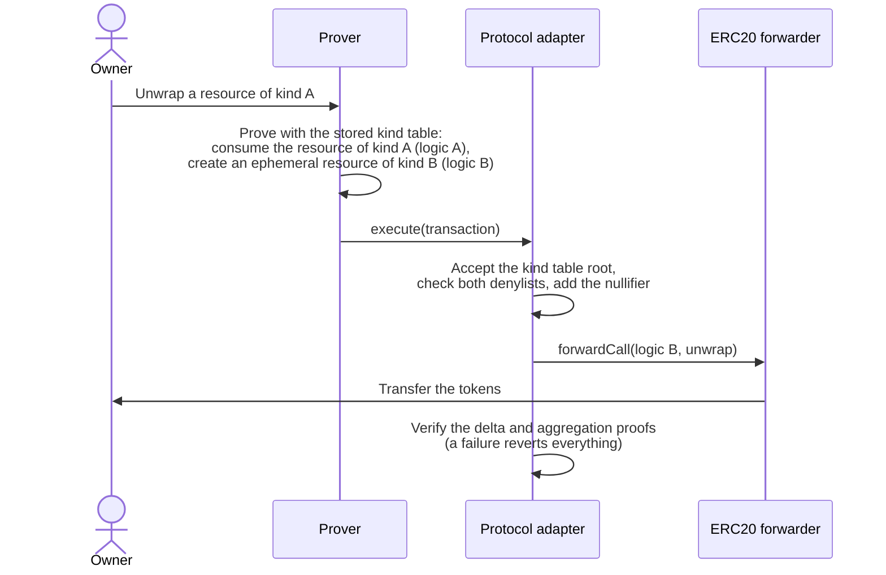

# Resource Kind Migration — Specification & Architecture

This document specifies how resource owners move their resources from one kind to another: the soft migration moves them away from a circuit that is still trusted, and the hard migration away from a circuit with a flaw. It states what the protocol adapter provides for each, and what the application must add. The domain vocabulary is in [`CONTEXT.md`](../CONTEXT.md) and in the kind tables' [`CONTEXT.md`](https://github.com/anoma/risc0-kind-tables/blob/next/CONTEXT.md). The one-time state migration and asset migration of a chain are a different process: [`01-upgrades-and-state-migration.md`](./01-upgrades-and-state-migration.md#1-three-kinds-of-migration) separates the three. The ERC20 forwarder's part of a hard migration is in its [`02-hard-migration.md`](https://github.com/anoma/anomapay-erc20-forwarder/blob/next/docs/02-hard-migration.md).

## 1. Purpose

A resource logic is a circuit, and its logic ref identifies its code. A new circuit version has a new logic ref. The logic ref of a resource never changes, so a new version does not change the resources of an old one. Each owner moves their own resources to the new version, in their own transactions:

- **Soft migration** — the protocol adapter stops the creation of resources of kind A, with logic A, but still lets them be consumed. The kind table makes kind A fungible with kind B, with logic B, so a transaction can consume a resource of kind A and create one of kind B. The assumption: logic A is still trusted, and logic B is trusted.
- **Hard migration**, also called **emergency migration** — the protocol adapter stops both the consumption and the creation of resources of kind A, with logic A. A resource of kind B is created from a proof that an unspent resource of kind A, with the same quantity, exists in the state of the protocol adapter. The assumption: logic A has a flaw and is not trusted. Logic B is trusted.

The examples in this document use A for the kind that resources leave and B for the kind that they move to.

## 2. Kinds, kind points and the kind table

The kind of a resource is the hash of its logic ref and its label ref, as a point on an elliptic curve. The commitment of a resource covers both refs, so the kind of a resource never changes.

The compliance circuit puts the quantity of each resource into the delta with a **kind point**: the point that the kind table assigns to the kind of the resource, or the kind itself if the table has no entry for it. A transaction balances only if, for each kind point, the quantities of its consumed and its created resources are equal. So two kinds that the table assigns one kind point are fungible, and a transaction can consume a resource of one and create a resource of the other. Such a transaction is a **conversion**.

The protocol adapter stores one kind table root, which its owner sets. It accepts a transaction proven against the stored kind table or against the empty kind table, which assigns nothing ([ADR-0004](./adr/0004-the-transaction-carries-the-kind-table-root.md)). A transaction that balances with the empty table also balances with the stored one. So a kind table can make kinds fungible, but it cannot stop a kind. Only a conversion needs the stored table.

The kind tables repository builds the tables and publishes their roots, and its [ADR-0008](https://github.com/anoma/risc0-kind-tables/blob/next/docs/adr/0008-kinds-follow-the-forwarder.md) states the two rules that every table keeps:

- **R1 — One forwarder.** Two kinds may share one kind point only if one forwarder holds the tokens behind both. If the kind of WETH resources took the kind point of USDC resources, a user could wrap WETH and unwrap USDC. A kind point that two kinds share is a permission to create tokens, and a reviewer reads it as one.
- **R2 — Exit.** A kind with unspent resources must keep a way out: the forwarder accepts its logic ref, so its resources unwrap, or its kind point equals that of a kind that the forwarder accepts, so its resources convert first.

## 3. The denylists

The protocol adapter has two lists of logic refs: one for consumed resources and one for created resources. A transaction reverts with `ResourceWithDeniedLogicRef` if it consumes a resource whose logic ref is on the first list, or creates a resource whose logic ref is on the second. The owner adds entries with `denyLogicRefs`, and no function removes one.

| Status of a logic ref | List for consumed resources | List for created resources | A transaction can consume its resources | A transaction can create its resources |
| --- | --- | --- | --- | --- |
| Active | — | — | yes | yes |
| Deprecated | — | on the list | yes | no |
| Denied | on the list | on the list | no | no |

The lists hold logic refs, not kinds. So an entry applies to every kind with that logic ref, under every label, also to the resources of other applications with the same logic ref.

## 4. Soft migration

### Mechanism

A soft migration needs three changes:

1. **The kind table** assigns kind A the kind point of kind B. Kind A is then an alias of kind B, and a conversion from A to B balances.
2. **The forwarder** accepts logic B. A resource of kind A therefore unwraps only after it converts, either in an earlier transaction or in the same one.
3. **The protocol adapter deprecates logic A**: logic A goes on the list for created resources. No transaction creates a resource of kind A any more, and resources of kind A stay consumable.

Each owner then converts their resources of kind A when they spend them. A conversion consumes a resource of kind A, so the protocol adapter verifies a proof of logic A for it. That is why logic A must still be trusted: a flaw in logic A would let a forged resource of kind A convert into a resource of kind B.



### Case 1: a circuit release

A new version of the ERC20 transfer circuit, B, replaces the active version, A. Both have the label of the ERC20 forwarder, so one forwarder holds the tokens behind both (R1).

1. The kind tables repository lists B as the active version and A as deprecated. Each row of A becomes an alias of B under the same label.
2. The owner of each protocol adapter stores the new kind table root, in staging and then in production.
3. The owner of the ERC20 forwarder upgrades it to accept logic B. At the same time, the backend starts to create resources of version B and converts each resource of version A that it consumes.
4. The owner of each protocol adapter deprecates logic A. A transaction that creates a resource of version A reverts from then on, so this step waits until the backend creates none.

Version A stays in the kind table as long as resources of version A can exist (R2).

### Case 2: the legacy ERC20 forwarder

A chain that ran a legacy protocol adapter has legacy-forwarder resources. Their logic ref is `bc1232…`, circuit version 1.0.0, and their label names the legacy ERC20 forwarder. After the asset migration, the ERC20 forwarder holds their tokens (R1). The kind table makes each of them an alias of the active version under the label of the ERC20 forwarder, for each token whose `soft_migrate_from_legacy_forwarder` is `true` in the kind tables' `tokens.json`.

The owner of the protocol adapter deprecates `bc1232…` before the protocol adapter starts to execute transactions. The members make the two kinds fungible in both directions, so without the deprecation a transaction could convert resources of the ERC20 forwarder into new legacy-forwarder resources. The ERC20 forwarder accepts another logic ref, `51c2403f…`, so no wrap creates resources of `bc1232…`. A chain deployed fresh has no legacy-forwarder resources and skips this case. [`01-upgrades-and-state-migration.md`](./01-upgrades-and-state-migration.md#steps-of-a-state-migration) gives the order of these steps within the state migration.

### What the prover needs

A conversion needs the stored kind table, because only that table makes the two kinds fungible. Every other transaction can use the empty kind table, which stays valid when the owner stores a new root. A prover that loads a kind table before the protocol adapter stores its root makes proofs that revert with `UnacceptedKindTableRoot`. So a prover uses a kind table only once the protocol adapter stores its root, and the empty kind table before that.

A prover proves the consumption of a resource with the circuit that its logic ref names, and the creation of a resource with the circuit of the active version. So the prover keeps the program of logic A, for example of circuit version 1.0.0 for legacy-forwarder resources, as long as resources of kind A can exist.

## 5. Hard migration

### Mechanism

A hard migration needs four changes:

1. **The protocol adapter denies logic A**: logic A goes on both lists. No transaction consumes or creates a resource of kind A any more. A resource of kind A that a flaw forged therefore cannot be spent at the protocol adapter.
2. **Logic B proves the migration.** A hard migration transaction consumes an ephemeral resource of logic B, the trigger. The logic proof of the trigger computes, for each resource of kind A, the root of the commitment tree from its commitment and a Merkle path, and its nullifier. It requires one signature of the owner over the action tree root, and a total quantity of the resources of kind A that equals the quantity of the trigger. The transaction creates resources of kind B for that quantity, which balance the trigger.
3. **The application checks the proof against the protocol adapter and records the nullifiers**, because the protocol adapter has no function for a hard migration. The trigger calls the application with each root and nullifier. The application requires each root to be historical and each nullifier to be absent from the nullifier set of the protocol adapter, records the nullifier itself, and refuses a nullifier that it recorded before. The protocol adapter does not consume the resources of kind A, so its nullifier set does not change.
4. **The forwarder accepts logic B**, so the created resources unwrap.

No proof of logic A runs again. Only logic B and the checks of the application decide whether a resource of kind A existed and was unspent. That is why a hard migration works for a logic A with a flaw.

```mermaid
sequenceDiagram
    actor Owner
    participant Prover
    participant PA as Protocol adapter
    participant Fwd as Hard-migrating ERC20 forwarder

    Owner->>Prover: Hard-migrate resources of kind A
    Prover->>Prover: Prove with logic B: for each resource of kind A,<br/>the root and the nullifier; the total quantity
    Prover->>PA: execute(transaction)
    PA->>PA: Consume the trigger (logic B):<br/>check both denylists, add its nullifier
    PA->>Fwd: forwardCall(logic B, migrate the batch)
    Fwd->>PA: Logic A denied? Each root historical?<br/>Each nullifier not in the nullifier set?
    Fwd->>Fwd: Record each nullifier
    PA->>PA: Create the resources of kind B
    PA->>PA: Verify the delta and aggregation proofs<br/>(a failure reverts everything)
```

### Why any historical root works

After the denial, no transaction can create a resource of kind A. So a later root contains no resource of kind A that an earlier root does not contain, and every root after the denial contains the same resources of kind A. The nullifier checks stop a second migration of a resource, whichever root its proof uses. A prover can therefore use the latest root of the protocol adapter.

### Correct and forged resources

A flaw in logic A can let a person create a resource of kind A that no wrap backs, or consume a resource of another owner. The state of the protocol adapter cannot tell such a resource from a correct one: resources are private, and a transaction that uses the flaw looks correct on chain.

- After a **precautionary denial** — the flaw is found before anyone uses it — every resource of kind A in the commitment tree is correct, and the hard migration moves only correct resources.
- After a **possible exploit**, forged and correct resources are under the same roots, and no proof separates them. The hard migration moves both. The loss between the exploit and the denial is not recovered.

### Steps after a flaw

1. Pause the protocol adapter. It executes no transaction from then on.
2. Deny logic A.
3. Upgrade the application to an implementation that hard-migrates resources of logic A and accepts logic B. For ERC20 resources, that is `EmergencyMigratingERC20Forwarder`.
4. The kind tables repository lists B as the active version and keeps A, whose rows no transaction can use any more. Store the new kind table root.
5. Lift the pause.
6. Resource owners hard-migrate their resources of kind A, and soft-migrate their resources of the deprecated versions without the flaw.

In production, steps 1, 2, 4 and 5 are transactions of the PA Safe, and step 3 is a transaction of the owner of the application.

### Status

The hard migration of ERC20 resources is a draft. The ERC20 forwarder's [`02-hard-migration.md`](https://github.com/anoma/anomapay-erc20-forwarder/blob/next/docs/02-hard-migration.md) specifies its two parts: the forwarder `EmergencyMigratingERC20Forwarder`, and the emergency-migrating ERC20 circuit (`47ab0d90…`), which can be logic B because it has the migrate call. The active version 2.0.0-rc.1 (`51c2403f…`) has no migrate call. No environment runs either part.

## 6. Soft and hard migration compared

| | Soft migration | Hard migration |
| --- | --- | --- |
| Trust in logic A | Trusted | Not trusted: it has a flaw |
| Logic A on the denylists | Created resources: deprecated | Consumed and created resources: denied |
| A resource of kind A is | consumed at the protocol adapter, with a proof of logic A | not consumed: logic B proves that it exists, and the application checks that it is unspent |
| What balances the quantities | The delta, because the kind table gives A and B one kind point | The trigger: logic B requires its quantity to equal the total of the resources of kind A, and the resources of kind B balance it |
| Nullifier of a resource of kind A | Added to the nullifier set of the protocol adapter | Recorded by the application, for example the ERC20 forwarder |
| Kind table | A is an alias of B | The rows of A stay listed, and no transaction can use them |
| Contract changes | The kind table root, the accepted logic ref of the forwarder, the deprecation of logic A | The denial of logic A, and an upgrade of the application to a hard-migrating implementation |
| Who acts | Each resource owner, in their own transactions | Each resource owner, in their own transactions |
| Status | In use: the legacy-forwarder resources on Sepolia in staging | Draft |

## 7. Trust assumptions

- **A soft migration carries a flaw of logic A into kind B.** Until the owner denies logic A, a forged resource of kind A converts into an ordinary resource of kind B. A logic with a known flaw therefore gets a hard migration, not a soft one.
- **A shared kind point is a permission to create tokens.** R1 holds only if one forwarder holds the tokens behind every kind of a fungibility domain. The kind tables repository checks the tables offline and on chain, but only a reviewer catches a wrong token in its input.
- **Every kind with unspent resources keeps an exit.** R2 breaks if a release removes an alias from the kind table while resources of its kind exist.
- **The application decides what a hard migration creates.** The protocol adapter only verifies the proofs and the denylists. Which resources can migrate, and for which quantity, is decided by logic B and by the checks of the application.
- **Denylist entries are permanent.** An upgrade of the protocol adapter that removes the denial of logic A lets the protocol adapter consume resources of kind A again, also those that an owner hard-migrated already, which are then spent twice. The ERC20 forwarder refuses every hard migration while logic A is not denied.
