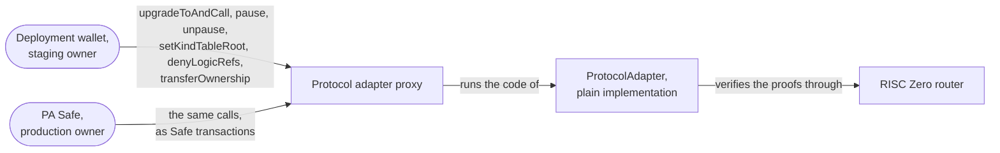
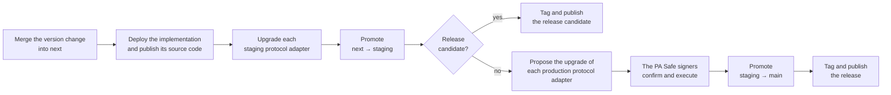

# Protocol Adapter Upgrades — Specification & Architecture

This document specifies how the protocol adapter changes after its deployment. It covers the upgrades in the staging and the production environment, the other actions of the owner, and the response to a flaw. On a migrated chain, the protocol adapter first copies the state of the legacy protocol adapter, as [`01-state-migration.md`](./01-state-migration.md) specifies. After that, the protocol adapter changes only as this document specifies. The [overview](./00-galileo-upgrade.md) explains the terms. [`RELEASE_CHECKLIST.md`](../RELEASE_CHECKLIST.md) has the commands.

## 1. Contracts and owners

- **Protocol adapter.** An ERC-1967 proxy in the UUPS pattern. Each upgrade keeps its address, its commitment tree, its nullifier set, its kind table root and its denylists. Its address comes from CREATE2. The address depends on the salt of its environment and on the deployment code, which contains the first implementation and the first owner. On a migrated chain, the protocol adapter starts on the migrational implementation. So its address is different from the address on a chain without a state migration.
- **Plain implementation.** `ProtocolAdapter`. Its code contains its version (`VERSION`), the address of the RISC Zero router and the verifier selector. It also contains the verifying keys of the compliance circuit and the aggregation circuit. So each change of these values needs an upgrade. Both environments deploy the implementation with the same CREATE2 salt. So they use the same implementation of a version on a chain.
- **RISC Zero router.** A contract that sends each proof to a RISC Zero verifier contract. The first four bytes of a proof, the **verifier selector**, select the verifier. The protocol adapter accepts only proofs with its own verifier selector.

The owner of the protocol adapter can do these actions:

- upgrade it (`upgradeToAndCall`),
- pause it and lift the pause (`pause`, `unpause`),
- set the kind table root (`setKindTableRoot`),
- deprecate or deny logic refs (`denyLogicRefs`),
- transfer the ownership.

| Environment | Owner | How the owner acts | Branch |
| --- | --- | --- | --- |
| Staging | The deployment wallet | It sends each chain transaction directly. | `staging` |
| Production | The PA Safe | A script proposes the Safe transaction. Then the signers confirm and execute it in the Safe app. | `main` |

## 2. Environments and promotion

The source code moves through three branches in one direction: `next` → `staging` → `main` ([ADR-0003](./adr/0003-deployments-are-promoted-from-next-through-staging-to-main.md)). A **promotion** is a pull request that moves the source code to the following branch. Its checks, the **promotion gate**, compare the deployments with the source code:

- `next` receives the changes. Its checks do not read deployments.
- A pull request into `staging` passes only if each staging protocol adapter uses the implementation that the source code predicts for its chain. The deploy script calculates the CREATE2 address of that implementation.
- A pull request into `main` passes only if these conditions are true:
  - Each production protocol adapter uses that implementation.
  - The version is not a release candidate.
  - A Safe owns each production protocol adapter.

A **release candidate** is a test version, with the suffix `-rc.N` in its version. The team deploys only source code that is in `next`. This is a rule of the team, and the promotion gate does not check it.

The version is part of the code of the implementation. So each version is a different implementation at a different address. A version without the suffix `-rc.N` is also a new implementation. For this reason, the team deploys the final version of a release first to staging, and then to production.

## 3. Upgrades

An upgrade replaces the implementation of the protocol adapter. It keeps the address and the state. If an upgrade changes a verifying key or the verifier selector, each proof for the old values fails. Then each transaction with such a proof reverts, and the prover must make its proofs again. The function `execute` receives the transactions. If an upgrade changes its interface, the programs that send transactions need a new release at the same time.

### Steps

| Step | Staging | Production |
| --- | --- | --- |
| Deploy the implementation, and publish its source code on sourcify and Etherscan | `contracts-deploy-impl`, `contracts-verify-impl` | The same, if staging did not deploy it on that chain already |
| Upgrade each protocol adapter | The deployment wallet sends `contracts-execute-staging-upgrade`. | `contracts-propose-production-upgrade` proposes the upgrade to the PA Safe. Then its signers confirm and execute it. |
| Check each protocol adapter | `getImplementation()` returns the new implementation. | The same, after the signers executed the upgrade |
| Promote | `next` → `staging` | `staging` → `main` |
| Tag and publish | `contracts/vX.Y.Z-rc.N` and `bindings/vA.0.0-rc.N` | `contracts/vX.Y.Z` and `bindings/vA.0.0` |

The commands in the table are in the file `justfile` of the repository. Each command that sends a chain transaction has a simulation command. The simulation runs the same calls on a copy of the chain and sends nothing. The team runs the simulation first. The bindings have their own version numbers, `A.B.C`.

The PA Safe signers execute the upgrades chain by chain, so a production upgrade can take days. The promotion into `main` fails until the last chain uses the new implementation.

## 4. Other actions of the owner

These actions do not change the version. So they need no promotion, no tag and no publication.

| Action | Effect | Staging | Production |
| --- | --- | --- | --- |
| Set the kind table root | Transactions use the new kind table or the empty kind table. A transaction with a proof for the old kind table reverts with `UnacceptedKindTableRoot`. | `contracts-execute-staging-kind-table-update` | `contracts-propose-production-kind-table-update` |
| Pause | The protocol adapter executes no transaction. | `contracts-execute-staging-pause` | `contracts-propose-production-pause` |
| Lift the pause | The protocol adapter executes transactions again. | The deployment wallet calls `unpause()` with the Foundry command `cast send`. | The signers create a Safe transaction that calls `unpause()`. No command proposes it. |
| Deprecate or deny a logic ref | As the overview defines. [`03-resource-kind-migration.md`](./03-resource-kind-migration.md#3-the-denylists) explains the denylists. | `contracts-execute-staging-logic-ref-denial` | `contracts-propose-production-logic-ref-denial` |

The kind tables repository publishes one kind table root for each chain and environment. Its promotion gate fails until each protocol adapter of the environment stores the published root.

## 5. Response to a flaw

The protocol adapter verifies every proof, and it accepts every valid proof, from any prover. A prover that refuses to make proofs does not prevent the use of a flaw, because anyone can make proofs with a published circuit. Only contracts on the chain can prevent the use of a flaw. These are the protocol adapter, with three actions of its owner, and the RISC Zero verifiers, with their emergency stops.

- **Pause.** The protocol adapter executes no transaction until the owner lifts the pause.
- **Deny a logic ref.** The protocol adapter reverts each transaction that consumes or creates a resource with that logic ref.
- **Upgrade.** A new implementation replaces flawed code, a flawed verifying key or the verifier selector.
- **The emergency stop of a RISC Zero verifier.** The RISC Zero router sends each proof to an emergency stop contract, which sends the proof to the verifier. Its **guardian** can stop the verifier. Anyone who presents a valid proof for an impossible claim can also stop it. No function restarts a stopped verifier. From then on, `execute` reverts, and `riscZeroVerifierPaused()` returns `true`.

The RISC Zero router and the emergency stops have their own owners and guardians. This document does not list them.

| Flaw in | Response |
| --- | --- |
| The protocol adapter code, the compliance circuit or the aggregation circuit | Pause. Upgrade the protocol adapter. Lift the pause. |
| The RISC Zero verifier | Pause, or stop the verifier with its emergency stop. The owner of the RISC Zero router adds a correct verifier with a new verifier selector. Upgrade the protocol adapter to an implementation with that selector. Lift the pause. The provers make the proofs of their transactions again. |
| A resource logic or a forwarder | Pause. Deny the logic ref, if the flaw is in a resource logic. The owner of the application upgrades its contracts. Lift the pause. For ERC20 resources, the ERC20 forwarder's [`02-upgrades.md`](https://github.com/anoma/anomapay-erc20-forwarder/blob/next/docs/02-upgrades.md#3-response-to-a-flaw) gives the steps. |

In production, each action of the owner is a Safe transaction, so it waits for the PA Safe signers. The emergency stop of a RISC Zero verifier does not wait for them.

## 6. Trust assumptions

- **The owner can change every rule.** An upgrade replaces all code. So the owner can change how the protocol adapter reads and writes its state. In production, the PA Safe signers decide each upgrade.
- **The PA Safe signers respond to a flaw in time.** Each response, except the emergency stop of a RISC Zero verifier, is a Safe transaction.
- **The owner of the RISC Zero router and the guardians act correctly.** They select the verifier of each verifier selector, and they can stop a verifier.
- **The kind table root decides which kinds are fungible.** So the owner sets only roots that the kind tables repository published ([`03-resource-kind-migration.md`](./03-resource-kind-migration.md#2-the-kind-table)).
- **An upgrade can remove a denylist entry.** No function removes an entry, but a new implementation can change the denylists.

## 7. Parameters

| Name | Value | Use |
| --- | --- | --- |
| `Parameters.PROXY_SALT_STAGING` | `"ProtocolAdapterProxyStaging"` | CREATE2 salt of the staging protocol adapters |
| `Parameters.PROXY_SALT_PRODUCTION` | `"ProtocolAdapterProxyProduction"` | CREATE2 salt of the production protocol adapters |
| `Parameters.IMPLEMENTATION_SALT` | `"ProtocolAdapterImpl"` | CREATE2 salt of the implementations, in both environments |
| `EMPTY_KIND_TABLE_ROOT` | `0xcc1d2f838445db7aec431df9ee8a871f40e7aa5e064fc056633ef8c60fab7b06`, which is `sha256("EMPTY")` | Root of the empty kind table, which the protocol adapter always accepts |

The [overview](./00-galileo-upgrade.md#accounts-and-controls) gives the addresses of the deployment wallet and the PA Safe. The deployment record, [`crates/bindings/deployments.json`](../crates/bindings/deployments.json), lists the protocol adapters of each environment.
