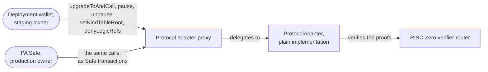
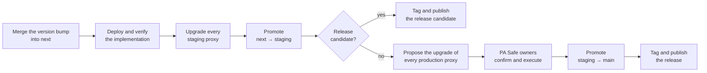

# Upgrades — Specification & Architecture

This document specifies how the protocol adapter changes after its deployment: the upgrades of its implementation in the staging and the production environment, the owner actions that are not releases, and the forced upgrades that answer a flaw. A chain that ran a legacy protocol adapter first moves to the protocol adapter once, in the state migration of [`01-state-migration.md`](./01-state-migration.md), and after that changes only by the upgrades of this document. The domain vocabulary is in [`CONTEXT.md`](../CONTEXT.md), and the commands are in [`RELEASE_CHECKLIST.md`](../RELEASE_CHECKLIST.md). How resource owners move their resources from one kind to another, after a circuit release or a flaw, is in [`03-resource-kind-migration.md`](./03-resource-kind-migration.md).

## 1. Contracts and owners

- **Protocol adapter.** An ERC-1967 proxy that delegates every call to its implementation. It upgrades with UUPS: the implementation authorizes the upgrade, and only the owner can do it. The proxy keeps its address, its commitment tree, its nullifier set, its kind table root and its denylists across upgrades. Its address comes from CREATE2 and commits to the salt of its environment, to the implementation that it starts on and to its first owner.
- **Plain implementation.** `ProtocolAdapter`, the implementation that every chain runs after its deployment or its state migration. Its bytecode fixes `VERSION`, the RISC Zero verifier router and selector, and the verifying keys of the compliance and aggregation circuits (`VerifyingKeys`). So a change to any of them is an upgrade. Both environments deploy it with one CREATE2 salt, so each version has one address per chain, which both environments share.

The owner of the proxy can upgrade it (`upgradeToAndCall`), pause it and lift the pause (`pause`, `unpause`), set the kind table root (`setKindTableRoot`), add logic refs to the denylists (`denyLogicRefs`), and transfer ownership.

| Environment | Owner | How the owner acts | Branch |
| --- | --- | --- | --- |
| Staging | the deployment wallet `0x61462bE56782568376f9cB069382EFa72764a407` | sends each transaction directly | `staging` |
| Production | the PA Safe `0xE9082Ac8Aa2Fb27DEfDBAC604921C196b884Da10`, a Safe multisig that needs 3 of its 5 owners to confirm a transaction | a script proposes the transaction, and the Safe owners confirm and execute it in the Safe app | `main` |

## 2. Environments and promotion

Changes go in one direction: `next` → `staging` → `main` ([ADR-0003](./adr/0003-deployments-are-promoted-from-next-through-staging-to-main.md)). `next` collects the feature branches and makes no statement about deployments. A pull request into `staging` passes only if every staging proxy runs the implementation that the source predicts for its chain. A pull request into `main` passes only if every production proxy runs it, its version has no prerelease suffix, and a Safe owns the proxy. So a deployment follows the merge into `next`, and the promotion pull request proves that the environment runs the merged source.

`VERSION` is a constant in the bytecode, so each version is a different implementation at a different address. Removing the `-rc.N` suffix is also a new implementation. The release version therefore runs in staging before it runs in production.

## 3. Upgrades

An upgrade replaces the implementation. It keeps the address and the state. If an upgrade changes the verifying keys or the RISC Zero verifier selector, a proof made for the old ones fails. The transactions that are proven but not yet executed then revert, and their owners prove them again. A change to the ABI of `execute` needs a release of the clients at the same time.

### Steps

| Step | Staging | Production |
| --- | --- | --- |
| Deploy the implementation and verify it on sourcify and Etherscan | `contracts-deploy-impl`, `contracts-verify-impl` | the same, unless staging deployed it on that chain already |
| Upgrade each proxy | the deployment wallet executes `contracts-execute-staging-upgrade` | `contracts-propose-production-upgrade` proposes the upgrade to the PA Safe, and its owners confirm and execute it |
| Check each proxy | `getImplementation()` returns the new implementation | the same, after the Safe owners executed |
| Promote | `next` → `staging` | `staging` → `main` |
| Tag and publish | `contracts/vX.Y.Z-rc.N` and `bindings/vA.0.0-rc.N` | `contracts/vX.Y.Z` and `bindings/vA.0.0` |

Each recipe that sends a transaction has a simulation recipe, which runs first. The PA Safe owners execute chain by chain, so a production rollout can take days. The promotion into `main` stays red until the last chain runs the new implementation.

## 4. Owner actions that are not releases

These actions do not change `VERSION`, so they need no promotion, no tag and no publication.

| Action | Effect | Staging | Production |
| --- | --- | --- | --- |
| Set the kind table root | Transactions are proven against the new kind table or against the empty one. A proof made with the replaced table reverts with `UnacceptedKindTableRoot`. | `contracts-execute-staging-kind-table-update` | `contracts-propose-production-kind-table-update` |
| Pause | The protocol adapter executes no transaction. | `contracts-execute-staging-pause` | `contracts-propose-production-pause` |
| Lift the pause | The protocol adapter executes transactions again. | `cast send <PROXY> "unpause()"` from the deployment wallet | a Safe transaction that calls `unpause()`; no recipe proposes it |
| Deprecate or deny a logic ref | Deprecate: no transaction creates its resources. Deny: no transaction consumes or creates them. No function removes the entry. | `contracts-execute-staging-logic-ref-denial` | `contracts-propose-production-logic-ref-denial` |

The kind tables repository publishes the kind table roots, one for each chain and environment. Its promotion gate requires every protocol adapter of the environment to store the published root.

## 5. Forced upgrades

A forced upgrade answers a flaw, and the flaw decides when it happens. Every proof passes through the protocol adapter, which accepts any valid proof, whoever made it. So the protocol adapter is the only place that can stop a flaw: a prover that refuses to prove changes nothing, because anyone can prove with a published circuit. The owner has three controls, and the RISC Zero verifier has a fourth:

- **Pause.** The protocol adapter executes no transaction until the owner lifts the pause.
- **Deny a logic ref.** The protocol adapter reverts on each transaction that consumes or creates a resource of that logic ref. No function removes the entry.
- **Upgrade.** A new implementation replaces flawed code, a flawed verifying key or the verifier selector.
- **The emergency stop of the RISC Zero verifier.** Its guardian, or anyone who presents a proof of the exploit, stops the verifier, and nothing restarts it. From then on, `execute` reverts and `riscZeroVerifierPaused()` returns `true`.

| Flaw in | Response |
| --- | --- |
| The protocol adapter code, or the compliance or the aggregation circuit | Pause. Upgrade the protocol adapter. Lift the pause. |
| The RISC Zero verifier | Pause, or stop the verifier with its emergency stop. The router owner adds a fixed verifier under a new selector. Upgrade the protocol adapter to an implementation with that selector. Lift the pause. The owners of the transactions that are proven but not yet executed prove them again. |
| A resource logic, for example a version of the ERC20 transfer circuit | Pause. Deny the logic ref. Upgrade the application, for example the ERC20 forwarder, so that resource owners can hard-migrate their resources. Lift the pause. See [`03-resource-kind-migration.md`](./03-resource-kind-migration.md#5-hard-migration). |
| The code of a forwarder | Pause. The owner of the forwarder upgrades it. Lift the pause. A forwarder acts only on calls from its protocol adapter, so the pause stops it too. |

In production, each owner action is a Safe transaction and waits for 3 of the 5 owners of the PA Safe. The emergency stop of the RISC Zero verifier does not wait for them.

## 6. Trust assumptions

- **The owner can change every rule.** An upgrade replaces all code, so the owner can change how the protocol adapter reads and writes its state. In production, this relies on 3 of the 5 owners of the PA Safe.
- **The PA Safe owners answer a flaw in time.** Each response except the emergency stop of the RISC Zero verifier is a Safe transaction, so it waits until 3 of the 5 owners confirm it.
- **A kind table root is a permission.** A table that gives two kinds one kind point lets transactions convert one into the other. The owner sets only roots that the kind tables repository published. See [`03-resource-kind-migration.md`](./03-resource-kind-migration.md#2-kinds-kind-points-and-the-kind-table).
- **Denylist entries are permanent.** No function removes an entry. Only an upgrade can.

## 7. Parameters

| Name | Value | Used for |
| --- | --- | --- |
| `Parameters.DEPLOYMENT_WALLET` | `0x61462bE56782568376f9cB069382EFa72764a407` | Owner of the staging proxies |
| `Parameters.PA_MULTISIG`, the PA Safe | `0xE9082Ac8Aa2Fb27DEfDBAC604921C196b884Da10`, 3 of 5 | Owner of the production proxies |
| `Parameters.PROXY_SALT_STAGING` | `"ProtocolAdapterProxyStaging"` | CREATE2 salt of the staging proxies |
| `Parameters.PROXY_SALT_PRODUCTION` | `"ProtocolAdapterProxyProduction"` | CREATE2 salt of the production proxies |
| `Parameters.IMPLEMENTATION_SALT` | `"ProtocolAdapterImpl"` | CREATE2 salt of the implementations, in both environments |
| `EMPTY_KIND_TABLE_ROOT` | `0xcc1d2f838445db7aec431df9ee8a871f40e7aa5e064fc056633ef8c60fab7b06`, `sha256("EMPTY")` | The root of the empty kind table, which the protocol adapter always accepts |

[`crates/bindings/deployments.json`](../crates/bindings/deployments.json) records the proxies of each environment.
