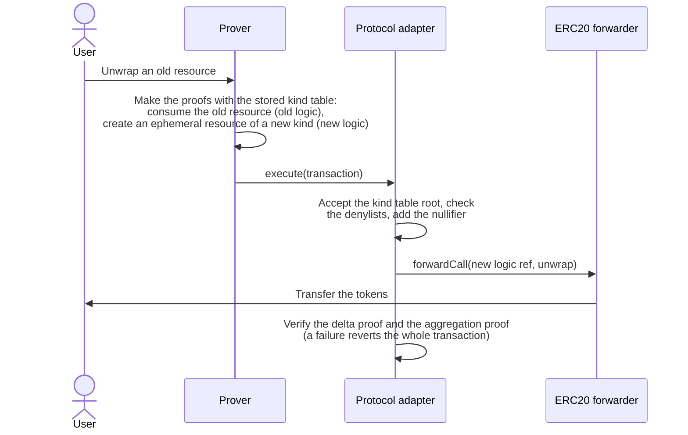

# Resource Kind Migration — Specification & Architecture

This document specifies the two resource kind migrations: the soft migration and the hard migration. In both, users replace their resources with resources of another kind. The soft migration replaces resources of a resource logic that can still be trusted. The hard migration replaces resources of a resource logic with a flaw. This document states what the protocol adapter provides for each migration, and what the application must add. The [overview](./00-galileo-upgrade.md) explains the terms. The ERC20 forwarder's [`03-hard-migration.md`](https://github.com/anoma/anomapay-erc20-forwarder/blob/next/docs/03-hard-migration.md) specifies the hard migration of ERC20 resources.

## 1. Purpose

A new version of a resource logic has a new logic ref. The logic ref of a resource never changes. So a new version does not change the resources that exist. Each user replaces their own resources, in their own transactions.

In this document, the **old logic** is the resource logic of the resources that users replace. The **old kinds** are its kinds, one for each label ref. The **new logic** and the **new kinds** are the resource logic and the kinds of the resources that replace them. An **old resource** is a resource of an old kind.

- **Soft migration.** The owner of the protocol adapter prevents the creation of old resources, but transactions can still consume them. The kind table makes each old kind fungible with the new kind that has the same label ref. So a transaction can consume an old resource and create a resource of a new kind. The assumption: the old logic can still be trusted, and the new logic is trustworthy.
- **Hard migration.** The owner of the protocol adapter prevents the creation and the consumption of old resources. A transaction proves that an unspent old resource exists in the state of the protocol adapter. Then it creates a resource of a new kind with the same quantity. The assumption: the old logic has a flaw and cannot be trusted. The new logic is trustworthy.

## 2. The kind table

The protocol adapter stores one kind table root, which its owner sets. Each transaction states the root of the kind table that its proofs use. The protocol adapter accepts two roots: the stored root, and the root of the empty kind table, which has no entries ([ADR-0004](./adr/0004-the-transaction-carries-the-kind-table-root.md)). It reverts a transaction with another root. A transaction that balances with the empty kind table also balances with the stored kind table. So a kind table can make kinds fungible, but it cannot block a kind. Only a conversion needs the stored kind table.

The kind tables repository makes the kind tables and publishes their roots. Its [ADR-0008](https://github.com/anoma/risc0-kind-tables/blob/next/docs/adr/0008-kinds-follow-the-forwarder.md) gives two rules for each kind table:

- **R1: one token, one forwarder.** Two kinds can have the same kind point only if their resources represent the same token, and one forwarder holds that token for both. For example, if WETH resources have the kind point of USDC resources, a user can wrap WETH and unwrap USDC. So a reviewer checks each shared kind point as if it can create tokens.
- **R2: a way to unwrap.** Each kind with unspent resources must keep a way to unwrap. There are two possible ways. The forwarder accepts its logic ref, so its resources unwrap. Or its kind point is the kind point of a kind whose logic ref the forwarder accepts, so its resources convert first.

## 3. The denylists

A transaction reverts with `ResourceWithDeniedLogicRef` in two cases:

- It consumes a resource whose logic ref is on the list for consumed resources.
- It creates a resource whose logic ref is on the list for created resources.

The owner adds entries with `denyLogicRefs`. No function removes an entry.

| Status of a logic ref | On the list for consumed resources | On the list for created resources | Transactions can consume its resources | Transactions can create its resources |
| --- | --- | --- | --- | --- |
| Allowed | no | no | yes | yes |
| Deprecated | no | yes | yes | no |
| Denied | yes | yes | no | no |

The lists contain logic refs, not kinds. So an entry applies to all kinds with that logic ref, with any label ref. This includes the resources of other applications with the same logic ref.

## 4. Soft migration

### Mechanism

A soft migration needs three changes:

1. **The kind table** gives each old kind the kind point of the new kind with the same label ref. So a conversion from an old kind to a new kind balances.
2. **The forwarder** accepts only the new logic. So an old resource can unwrap only after a conversion, in an earlier transaction or in the same transaction.
3. **The owner of the protocol adapter deprecates the old logic.** After this, no transaction can create an old resource. Transactions can still consume old resources.

Each user converts their old resources when they use them in a transaction. A conversion consumes an old resource, so the protocol adapter verifies a proof of the old logic for it. For this reason, the old logic must still be trusted. If the old logic has a flaw, a forged old resource can become a resource of a new kind.

### Case 1: a circuit release

A new version of the ERC20 resource logic replaces the active version. The resources of both versions have the label ref of the ERC20 forwarder. So one forwarder holds their tokens (R1).

1. The kind tables repository lists the new version as active. The old version stays in the list. Each kind of the old version gets the kind point of the kind of the new version with the same label ref.
2. The owner of each protocol adapter sets the new kind table root, first in staging, then in production.
3. The owner of the ERC20 forwarder upgrades it, so that it accepts the logic ref of the new version. At the same time, the AnomaPay backend starts to create resources of the new version. A wrap or an unwrap that the backend proved for the old version reverts after the upgrade. The backend then proves it again for the new version.
4. The owner of each protocol adapter deprecates the logic ref of the old version. After this, a transaction that creates a resource of the old version reverts. So this step occurs only when the backend no longer creates resources of the old version.

Because of the deprecation, the number of resources of the old version can only decrease. The kind table keeps the entries of the old version while such resources exist (R2). The kind tables repository removes these entries only when no resource of the old version is unspent.

### Case 2: the legacy ERC20 forwarder

A migrated chain has legacy-forwarder resources. Their logic ref is `bc123236…`, version 1.0.0, and their label ref names the legacy ERC20 forwarder. After the asset migration, the ERC20 forwarder holds their tokens (R1). The legacy-forwarder entries make them fungible with the resources of the same token, the active version and the label ref of the ERC20 forwarder. The kind tables repository writes these entries only for the tokens that the ERC20 forwarder's [`01-asset-migration.md`](https://github.com/anoma/anomapay-erc20-forwarder/blob/next/docs/01-asset-migration.md#7-the-list-of-tokens) requires.

The owner of the protocol adapter deprecates `bc123236…` before the completion run lifts the pause. The legacy-forwarder entries make the kinds fungible in both directions. So without the deprecation, a transaction can convert resources of the ERC20 forwarder into new legacy-forwarder resources. This has two bad effects:

- The number of legacy-forwarder resources can increase. Then the kind table must keep their entries for an unlimited time.
- The hard migration of the ERC20 forwarder does not check the logic ref of legacy-forwarder resources. It depends on the fact that no transaction creates legacy-forwarder resources after the state migration (the ERC20 forwarder's [`03-hard-migration.md`](https://github.com/anoma/anomapay-erc20-forwarder/blob/next/docs/03-hard-migration.md#6-which-resources-can-hard-migrate)).

The ERC20 forwarder accepts another logic ref, `51c2403f…`. So no wrap creates resources with `bc123236…`. The protocol adapter of a chain without a state migration contains no legacy-forwarder resources, so this case does not apply to it. [`01-state-migration.md`](./01-state-migration.md#5-steps) gives the order of these steps.

### What the prover needs

A conversion needs the stored kind table, because only that kind table makes the kinds fungible. Other transactions can use the empty kind table, which stays valid when the owner sets a new root. A transaction with a proof for a kind table that the protocol adapter does not store reverts with `UnacceptedKindTableRoot`. So a prover uses a new kind table only after the protocol adapter stores its root. Before that, the prover uses the old stored kind table or the empty kind table.

A prover proves the consumption of a resource with the circuit that the logic ref of the resource identifies. It proves the creation of a resource with the circuit of the active version. So the prover keeps the circuit of the old logic while old resources can exist. For legacy-forwarder resources, that is the circuit of version 1.0.0.

## 5. Hard migration

### Mechanism

A hard migration needs four changes:

1. **The owner of the protocol adapter denies the old logic.** After this, no transaction can consume or create an old resource through the protocol adapter. So nobody can use a forged old resource there.
2. **The new logic checks the old resources.** A hard migration transaction consumes an ephemeral resource of the new logic, the **trigger**. For each old resource, the proof of the trigger calculates the root of the commitment tree from the commitment and a Merkle path. It also calculates the nullifier of the old resource. The proof of the trigger requires one signature of the user over the action tree root. It also requires that the total quantity of the old resources is equal to the quantity of the trigger. The transaction creates resources of a new kind for that quantity.
3. **The application checks each old resource against the protocol adapter, and it stores the nullifier.** The protocol adapter has no function for a hard migration, so the application does this work. It requires that each root is a historical root, and that the nullifier set of the protocol adapter does not contain the nullifier. It stores each nullifier, and it rejects a nullifier that it stored before. The protocol adapter does not consume the old resources, so its nullifier set does not change.
4. **The forwarder accepts the new logic.** So the new resources can unwrap.

The protocol adapter verifies no more proofs of the old logic. Only the new logic and the checks of the application decide if an old resource existed and was unspent. For this reason, a hard migration can replace the resources of an old logic with a flaw. The ERC20 forwarder's [`03-hard-migration.md`](https://github.com/anoma/anomapay-erc20-forwarder/blob/next/docs/03-hard-migration.md#4-the-forwarder) shows the flow of such a transaction.

### Why any historical root works

The commitment tree only grows, and after the denial no transaction adds an old resource. So the commitment tree at the latest root contains the commitment of each old resource. The tree at an earlier root contains a part of these commitments. The nullifier checks prevent a second migration of a resource, independent of the root that its proof uses. So any historical root works, and a prover can use the latest root. The application stores no root of its own.

The root check is necessary. Without it, a prover can make its own Merkle tree with the commitment of a resource that does not exist.

### Correct and forged resources

A flaw in the old logic can let an attacker create an old resource that no wrap paid for. It can also let an attacker consume a resource of another user. The state of the protocol adapter cannot show the difference between such a resource and a correct resource. Resources are private, and a transaction that uses the flaw looks correct on the chain.

- After a **precautionary denial**, the team finds the flaw, and nothing shows that anyone used it. If nobody used it, each old resource is correct, and the hard migration replaces only correct resources.
- After a **possible exploit**, forged and correct resources are in the same commitment tree, and no proof shows the difference. So the hard migration replaces both. Nothing replaces the tokens that the attacker took before the denial.

A root from before the start of the attack excludes the forged resources. But the start of an attack is usually unknown. Such a root also excludes each correct resource that a user created after it. Nobody can tell these resources apart, so the team cannot give their tokens to the correct users. For these reasons, the hard migration accepts any historical root.

### Steps after a flaw

The owner of the protocol adapter pauses it and denies the old logic. The owner of the application upgrades its contracts, so that they hard-migrate the old resources. Then the owner of the protocol adapter lifts the pause. For ERC20 resources, the ERC20 forwarder's [`03-hard-migration.md`](https://github.com/anoma/anomapay-erc20-forwarder/blob/next/docs/03-hard-migration.md#upgrade-after-a-flaw) gives all steps, and the status of the draft.

## 6. Comparison

| | Soft migration | Hard migration |
| --- | --- | --- |
| Old logic | Can still be trusted | Has a flaw and cannot be trusted |
| Denylists | The owner deprecates the old logic: no transaction creates old resources. | The owner denies the old logic: no transaction creates or consumes old resources. |
| An old resource | The protocol adapter consumes it, with a proof of the old logic. | The protocol adapter does not consume it. The new logic proves that it exists. The application checks that it is unspent. |
| Balance of quantities | The kind table gives the old kind and the new kind the same kind point. So the delta proof balances the old resource against the new resource. | The new logic requires that the quantity of the trigger is equal to the total of the old resources. The delta proof balances the trigger against the new resources. |
| Nullifier of an old resource | In the nullifier set of the protocol adapter | In the storage of the application |
| Kind table | Each old kind has the kind point of a new kind. | The entries of the old kinds stay, but no transaction can use them. |
| Contract changes | A new kind table root, a forwarder that accepts the new logic, and the deprecation of the old logic | The denial of the old logic, an upgrade of the application, and a new kind table root. After the upgrade, the forwarder accepts the new logic. |
| Status | In use for the legacy-forwarder resources on Sepolia, in staging | Draft |

## 7. Trust assumptions

- **A soft migration also replaces forged resources.** Until the owner denies the old logic, a forged old resource can convert into a resource of a new kind that looks correct. So the team uses a hard migration, not a soft migration, for a resource logic with a known flaw.
- **Each kind with unspent resources keeps a way to unwrap.** R2 fails if a release removes the entries of a kind while resources of that kind exist.
- **The application decides what a hard migration creates.** The protocol adapter only verifies the proofs and checks the denylists. The new logic and the checks of the application decide which resources can migrate, and for which quantity.
- **An upgrade can remove a denial.** No function removes a denylist entry. But if an upgrade of the protocol adapter removes the denial of the old logic, the protocol adapter can consume old resources again. This includes resources that a hard migration replaced already. They are then consumed twice. The ERC20 forwarder refuses each hard migration while the old logic is not denied.
